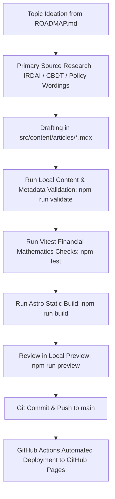

# Publishing Guide — Cover & Capital India

This guide outlines the complete workflow for creating, validating, and deploying articles to Cover & Capital India.

## Workflow Overview



## Step 1: Topic Selection
Select an unwritten topic from [editorial/ROADMAP.md](file:///c:/g/cover-and-capital-india/editorial/ROADMAP.md). Ensure foundational prerequisites are published first.

## Step 2: Primary Source Documentation
1. Retrieve primary legislation or IRDAI circulars.
2. If citing a specific insurer plan, obtain the official Product Brochure, Prospectus, and Sample Policy Bond from the insurer's official website using the IRDAI UIN.
3. Record exact circular numbers, clause titles, and effective dates in the frontmatter `sourceReferences`.

## Step 3: Drafting Content
1. Copy [editorial/ARTICLE-TEMPLATE.md](file:///c:/g/cover-and-capital-india/editorial/ARTICLE-TEMPLATE.md) to `src/content/articles/<slug>.mdx`.
2. Fill all frontmatter fields accurately. Set `reviewStatus: "draft"` during research.
3. Use KaTeX for mathematical expressions (`$$` for display equations, `$` for inline).
4. Use Mermaid code blocks (` ```mermaid `) for decision trees and policy lifecycle diagrams.
5. Provide detailed worked examples with transparent cash flows.

## Step 4: Verification & Build
Run the automated verification suite before committing:
```bash
# 1. Run unit tests for finance mathematics & calculators
npm test

# 2. Run editorial metadata & link integrity validation
npm run validate

# 3. Run production static build
npm run build
```

## Step 5: Publishing
1. Change frontmatter `reviewStatus: "approved"` and set `draft: false`.
2. Commit changes with a descriptive message: `feat(content): publish <slug>`.
3. Push to `main`. GitHub Actions will automatically validate, build, and deploy the artifact to GitHub Pages.
