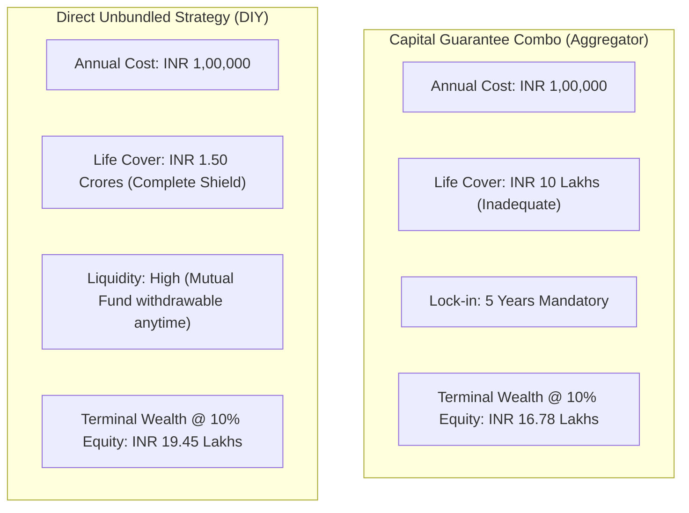

## 1. The Marketing Hook: Why Aggregators Promote "Capital Guarantee Solutions"

If you browse online insurance portals in India—most prominently web aggregators like **Policybazaar**—you will repeatedly encounter banner promotions for **"Capital Guarantee Solutions"** or **"Smart Capital Guarantee Plans"**.

The marketing proposition is engineered to appeal directly to the psychological biases of conservative Indian savers:
* *"100% Capital Guaranteed by Top Life Insurers!"*
* *"Enjoy Stock Market Upside with Zero Downside Risk!"*
* *"Double Benefit: Fixed Protection + High Growth!"*
* *"Tax-Free Maturity under Section 10(10D) / Schedule II(2)!"*

To a retail investor accustomed to fixed deposits or worried about stock market volatility, this sounds like the ultimate financial vehicle: the absolute safety of a bank fixed deposit combined with the high wealth-creation potential of equity mutual funds.

However, once you strip away the digital aggregator's marketing wrapper, the underlying financial engineering tells a very different story.

---

## 2. The Deconstruction: What Actually Happens Under the Hood?

A Capital Guarantee Solution is **not an independent product category recognized by the IRDAI**. In fact, Indian insurance regulations do not allow an insurance company to mix guaranteed non-linked funds directly with market-linked unit portfolios inside a single contract.

Instead, the aggregator sets up a **two-policy combo execution**:

```mermaid
flowchart TD
    Investor["Investor Annual Outlay: INR 1,00,000/yr"] --> Splitter["Aggregator Allocation Engine"]
    Splitter -->|INR 58,000/yr (58%)| LegA["Leg A: Non-Par Guaranteed Savings Policy"]
    Splitter -->|INR 42,000/yr (42%)| LegB["Leg B: Equity Unit-Linked Insurance Plan (ULIP)"]
    
    LegA --> OutA["Guarantees 100% of Total Premiums Paid (INR 10,00,000 at Year 10)<br/>Net IRR: ~5.6%"]
    LegB --> OutB["Invested in Nifty 50 Equity Index Fund at NAV<br/>Deducts FMC (1.35%) + Mortality Charges"]
    
    OutA --> Final["Terminal Payout: INR 10 Lakh Guaranteed + ULIP Fund Value"]
    OutB --> Final
```

### The Financial Engineering Formula
Suppose an investor commits to investing **INR 1,00,000 per year for a 10-year policy term**:
1. **The Capital Protection Leg (55% to 60% of Premium)**:
   * Approximately **INR 58,000** is routed into a Non-Participating Guaranteed Endowment Plan (e.g., from ICICI Prudential, HDFC Life, or Max Life).
   * Over 10 years, this leg absorbs INR 5,80,000 in premiums.
   * Compounding at an internal rate of roughly **5.5% to 5.7%**, this leg contractually matures at exactly **INR 10,00,000** at the end of Year 10.
   * **This is where the "100% Capital Guarantee" comes from.** It is simply a traditional debt policy whose maturity value matches the total INR 10,00,000 deposited across *both* policies!
2. **The Equity Growth Leg (40% to 45% of Premium)**:
   * The remaining **INR 42,000** is routed into an equity ULIP fund.
   * This leg is subject to monthly mortality charges, policy administration deductions, and a statutory Fund Management Charge (FMC) of up to 1.35% per annum.
   * At maturity, whatever fund value remains in this ULIP account is paid out as the "Market-Linked Upside".

---

## 3. The Mathematical Reality: Net Blended IRR Analysis

Let us evaluate the actual net return delivered to the investor over a **10-year investment horizon** with an annual outlay of **INR 1,00,000**:

### Cash-Flow Assumptions
* **Annual Outflow**: INR 1,00,000 at $t = 0, 1, 2, \dots, 9$ (Total Invested: INR 10,00,000).
* **Guaranteed Leg Maturity**: Exactly INR 10,00,000 at $t = 10$.
* **Equity ULIP Gross Market Return Scenarios**:
  * Moderate Market Scenario: 10.0% gross equity return.
  * Bull Market Scenario: 13.0% gross equity return.
  * Bear / Flat Market Scenario: 4.0% gross equity return.

### Net Terminal Values & True Portfolio IRR

| Market Scenario | Guaranteed Leg Maturity | ULIP Net Fund Value (after FMC & Mortality) | Total Terminal Corpus | Net Annualized Portfolio IRR |
|---|---|---|---|---|
| **Bear / Flat (4% Gross)** | INR 10,00,000 | INR 4,82,000 | **INR 14,82,000** | **4.91%** |
| **Moderate (10% Gross)** | INR 10,00,000 | INR 6,78,000 | **INR 16,78,000** | **7.12%** |
| **Bull Market (13% Gross)** | INR 10,00,000 | INR 8,04,000 | **INR 18,04,000** | **8.24%** |

### The Critical Takeaway
Even in a raging 10-year equity bull market where stocks deliver an extraordinary **13.0% annualized gross growth**, your overall Capital Guarantee Solution only delivers an **8.24% net IRR**! 

Why? Because nearly **60% of your capital was locked in a conservative debt product yielding 5.6%**. 

In an average or moderate equity market (10% gross), your net blended portfolio return is a modest **7.12%**. That is essentially identical to the risk-free, sovereign-backed Public Provident Fund (PPF) or Senior Citizens Savings Scheme—yet you took equity risk on 40% of your money and endured severe illiquidity.

---

## 4. The 4 Hidden Hazards of Platform Combo Solutions

### Hazard 1: Dual Layer of Administrative and Mortality Deductions
Because you hold two distinct policy contracts, the insurance companies deduct:
* **Dual Policy Administration Charges**: Monthly admin deductions across both the non-par contract and the ULIP.
* **Dual Mortality Deductions**: If you are a 35-year-old male, both policies charge mortality fees for their respective small life covers (e.g., INR 5.8 Lakh cover on Leg A, and INR 4.2 Lakh cover on Leg B).
* **Total Combined Life Cover**: Only **INR 10 Lakhs** (10 times the annual premium). For a breadwinner earning INR 15 Lakhs a year, a INR 10 Lakh death benefit is negligible.

### Hazard 2: The Double Liquidity Trap & Surrender Penalties
If an emergency strikes in Year 3 or Year 4:
* **Leg B (ULIP)**: Under IRDAI regulations, ULIPs have a **mandatory 5-year lock-in**. You cannot withdraw a single rupee from this fund before 60 months have elapsed.
* **Leg A (Guaranteed Non-Par)**: Surrendering an endowment plan in Year 3 incurs punitive early surrender penalties. Even under the revised IRDAI 2024 Special Surrender Value guidelines, you will lose a substantial portion of your paid premiums.
* Surrendering either leg completely demolishes the "Capital Guarantee" promise.

### Hazard 3: Tax Complexity Under the Income-tax Act, 2025
Under the modernized **Income-tax Act, 2025** (in force from 1 April 2026):
* **Leg B (ULIP)** is subject to the **INR 2.50 Lakh aggregate annual premium limit** for tax-exempt status under Schedule II(2).
* **Leg A (Non-Par)** is subject to the **INR 5.00 Lakh aggregate annual premium limit** for traditional policies.
* If you hold other insurance policies (e.g. an endowment bought in 2024 or another ULIP), adding this combo can unexpectedly push your total premiums over the statutory thresholds, triggering full income-tax liability at your personal slab rates upon maturity!

### Hazard 4: Massive Opportunity Cost Compared to Direct Asset Allocation
To protect your principal from market dips, you surrendered nearly half of the long-term compounding potential of Indian equity markets over a 10-year horizon.

---

## 5. The Head-to-Head Comparison: Capital Guarantee vs The DIY Unbundled Strategy

Instead of purchasing an aggregator's bundled combo, what happens if an investor implements the **Direct Unbundled Strategy (BTID + Sovereign Debt + Direct Index Fund)**?

### The DIY Portfolio Setup (INR 1,00,000 Annual Budget)
1. **Pure Term Life Cover**: Buy a INR 1.50 Crore pure term policy (e.g., HDFC Life Click 2 Protect or Max Life Smart Secure Plus) for **INR 12,000/year**.
2. **Sovereign Capital Protection (50%)**: Deposit **INR 44,000/year** into the **Public Provident Fund (PPF)** or **RBI Floating Rate Savings Bonds** (yielding 7.1%–7.75% sovereign guaranteed, tax-free).
3. **Wealth Acceleration (50%)**: Invest **INR 44,000/year** through a monthly automated SIP into a **Direct Nifty 50 Index Mutual Fund** (Total Expense Ratio: ~0.15%, zero mortality charge).

### 10-Year Head-to-Head Outcomes



| Parameter | Policybazaar Capital Guarantee Solution | Direct Unbundled DIY Portfolio | Advantage |
|---|---|---|---|
| **Annual Outlay** | INR 1,00,000 | INR 1,00,000 | Identical |
| **Life Insurance Cover** | **INR 10,00,000** (10x) | **INR 1,50,00,000** (150x) | **+INR 1.40 Crore Cover** |
| **10-Year Maturity Corpus (@ 10% Gross Equity)** | INR 16,78,000 | **INR 19,45,000** | **+INR 2.67 Lakhs Wealth** |
| **Net Portfolio IRR** | **7.12%** | **8.55%** | **+1.43% Annualized Return** |
| **Mid-Term Liquidity** | Zero before 5 years; punitive surrender fees | Mutual fund liquid in 48 hours; PPF loan/partial exit | **Superior Liquidity** |
| **Transparency** | Complex black-box actuarial deductions | Daily transparent NAV & sovereign G-Sec rates | **Complete Clarity** |

---

## 6. The Verdict: When (If Ever) Does a Capital Guarantee Plan Make Sense?

From a pure financial mathematics and fiduciary standpoint, **a Capital Guarantee Solution is rarely optimal for a financially literate investor**. 

The sole category of consumer for whom this product offers practical utility is:
* An investor who **lacks the behavioral discipline** to keep an index SIP running without stopping during market downturns, AND
* Who is ineligible for pure term life insurance due to severe pre-existing health conditions or lack of formal income documentation, AND
* Who values behavioral automation over financial optimization.

For everyone else:
1. Cover your Human Life Value with a dedicated **Pure Term Insurance Plan** (100x to 200x your premium).
2. Guarantee your core capital via **PPF, EPF, or Government of India Bonds**.
3. Generate long-term inflation-beating equity returns via **Direct Index Mutual Funds**.

By unbundling your protection from your investments, you secure **15 times higher life cover**, eliminate surrender penalties, and generate substantially higher net wealth.
