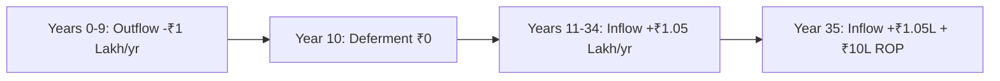

## 1. Deconstructing the "Guaranteed Return" Pitch
In the Indian bancassurance and agency channel, non-participating "Guaranteed Income Plans" are widely marketed to risk-averse savers with phrases such as:
* *"Pay ₹1,00,000 for 10 years, get Guaranteed ₹1,10,000 every year for 25 years + 100% money back!"*
* *"Guaranteed 11% annual income for life!"*

To a lay saver, "11% guaranteed income" sounds vastly superior to bank fixed deposits (6.5%–7.0%) or Public Provident Fund (7.1%).

However, in financial mathematics, **the payout ratio is not the rate of return**. You cannot calculate the return on a multi-period investment by dividing the cash inflow by a single year's premium. You must calculate the **Internal Rate of Return (IRR)**.

---

## 2. The Step-by-Step Cash-Flow Model
Consider the popular structure:
* **Premium Paying Term (PPT)**: 10 Years.
* **Annual Premium**: ₹1,00,000 (Outflow at $t = 0, 1, 2, \dots, 9$).
* **Deferment / Waiting Period**: 1 Year ($t = 10$).
* **Payout Period**: 25 Years ($t = 11$ to $t = 35$).
* **Annual Payout Received**: ₹1,05,000 per year.
* **Maturity / Terminal Benefit**: Return of all 10 premiums paid (₹10,00,000) at $t = 35$.

### The Cash-Flow Schedule

$$\sum_{t=0}^{35} \frac{CF_t}{(1 + r)^t} = 0$$

When you solve for $r$ using the Newton-Raphson root-finding algorithm:
$$\text{Actual Annual Cash-Flow IRR} = \mathbf{5.78\%}$$

### The Economic Reality
* Stated brochure headline: "10.5% Guaranteed Income".
* **Actual Net Annual Return**: **5.78%**.
* Over 35 years, locking capital at 5.78% in a developing economy with historical inflation around 5.5%–6.0% produces a **near-zero real return**.

---

## 3. Types of Bonuses in Traditional Policies
In traditional participating (with-profits) plans, returns depend on declared bonuses:

### A. Simple Reversionary Bonus
* Declared annually per thousand sum assured (e.g. ₹42 per ₹1,000 Sum Assured).
* Crucial trap: It is **not compounded**. It is simply credited to the policy account and paid out only on death or maturity, without earning interest.
$$\text{Annual Addition} = \text{Sum Assured} \times \frac{\text{Bonus Rate}}{1000}$$

### B. Compound Reversionary Bonus
* Added to the basic sum assured plus already accrued bonuses. Used by select private insurers.

### C. Terminal Bonus / Loyalty Additions
* Discretionary one-time additions paid at maturity. Insurers have no contractual obligation to pay a specific terminal bonus rate.

---

## 4. The ₹5,00,000 Statutory Tax Cap (Income-tax Act, 2025)
Under reforms originally introduced in Finance Act, 2023 and codified under **Schedule II, Clause 2** of the **Income-tax Act, 2025**:

1. **Threshold Rule**:
   * For non-ULIP policies issued on or after **1 April 2023**, maturity proceeds are exempt only if the **aggregate annual premium across all such policies does not exceed ₹5,00,000**.
2. **Taxation of High-Value Policies**:
   * If annual premium exceeds ₹5 Lakh, maturity proceeds are **taxable**.
   * Under CBDT Circular No. 15/2023, the taxable income is computed as:
   $$\text{Taxable Income} = \text{Maturity Sum Received} - \sum \text{Total Premiums Paid}$$
   * This net income is added to **Income from Other Sources** and taxed at normal applicable slab rates (e.g. up to 30% + surcharge).
3. **Pure Term Exemption**:
   * Pure term life insurance is explicitly **excluded** from this cap. Term death benefits remain 100% tax-free.
