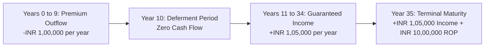
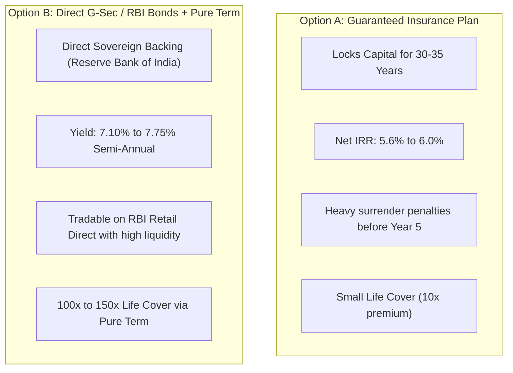

## 1. Deconstructing the "Guaranteed Income" Marketing Pitch

In the Indian retail insurance ecosystem—both on digital aggregators like **Policybazaar** and through private bank branches—non-participating **Guaranteed Savings & Income Plans** have become the primary product pitched to risk-averse savers.

Prominent market plans in this category include:
* **HDFC Life Sanchay Plus** (Long Term Income Option & Guaranteed Income Option)
* **ICICI Pru GIFT Pro** (Guaranteed Income For Tomorrow)
* **Max Life Smart Wealth Plan**
* **Tata AIA Fortune Guarantee Plus**
* **Bajaj Allianz Assured Wealth Goal**

The promotional brochures and portal listings feature compelling claims:
* *"Guaranteed 10.5% Annual Income for 25 Years!"*
* *"Pay for 10 Years, Get Guaranteed Tax-Free Income for Life + 100% Return of Premium!"*
* *"Shield Your Retirement with Fixed 12% Payouts!"*

To a saver comparing this against bank Fixed Deposits (6.5% to 7.0%) or Senior Citizens Savings Schemes (8.2%), a "10.5% guaranteed lifetime return" sounds extraordinary.

However, in financial mathematics, **a payout ratio is fundamentally different from a rate of return**. Dividing a single year's cash distribution by one year's premium violates the core principle of the time value of money.

---

## 2. Mathematical Proof: The 35-Year Cash-Flow Model

Let us analyze the exact contractual numbers of a representative guaranteed long-term income plan (such as **HDFC Life Sanchay Plus** or **ICICI Pru GIFT Pro**):

### Contract Parameters
* **Age of Policyholder**: 35 Years
* **Premium Paying Term (PPT)**: 10 Years ($t = 0$ to $t = 9$)
* **Annual Premium**: **INR 1,00,000** (Total Invested: **INR 10,00,000**)
* **Waiting / Deferment Period**: 1 Year ($t = 10$)
* **Payout Period**: 25 Years ($t = 11$ to $t = 35$)
* **Guaranteed Annual Payout**: **INR 1,05,000 per year**
* **Maturity Benefit (Year 35)**: Return of 100% of Premiums Paid (**INR 10,00,000**)

### The Cash Flow Timeline

### Solving for the Internal Rate of Return (IRR)

The Internal Rate of Return is the discount rate $r$ that solves the Net Present Value (NPV) equation to exactly zero:

$$\text{NPV} = \sum_{t=0}^{35} \frac{\text{CF}_t}{(1 + r)^t} = 0$$

$$\sum_{t=0}^{9} \frac{-\text{INR } 1,00,000}{(1 + r)^t} + \sum_{t=11}^{34} \frac{+\text{INR } 1,05,000}{(1 + r)^t} + \frac{+\text{INR } 11,05,000}{(1 + r)^{35}} = 0$$

Applying the standard Newton-Raphson polynomial solver:

$$\mathbf{\text{Actual Annual Cash-Flow IRR}} = \mathbf{5.78\%}$$

### The Mathematical Reality
* **The Agent's Pitch**: *"You get INR 1,05,000 on INR 1,00,000 premium—that is 105% of your annual premium, or a 10.5% return!"*
* **The Mathematical Reality**: The actual annualized compound return is **5.78%**.
* Over a 35-year horizon, locking your capital into an unalterable contract for a net yield of 5.78% is an underperformance compared to sovereign debt instruments.

---

## 3. Real Return After Inflation: The Fisher Equation Breakdown

The greatest hazard of guaranteed nominal contracts is the silent erosion caused by inflation. When an insurer promises you INR 1,05,000 in Year 25, that payout is fixed in **nominal rupees**, while the cost of food, healthcare, and education continues to rise.

Under the **Fisher Equation**, the real purchasing power return $r_{\text{real}}$ is:

$$1 + r_{\text{nominal}} = (1 + r_{\text{real}})(1 + i)$$

$$r_{\text{real}} = \frac{1 + r_{\text{nominal}}}{1 + i} - 1$$

Where:
* $r_{\text{nominal}} = 5.78\%$ (The policy's IRR).
* $i = 6.00\%$ (Long-term Indian Consumer Price Index inflation).

$$r_{\text{real}} = \frac{1 + 0.0578}{1 + 0.0600} - 1 = \frac{1.0578}{1.0600} - 1 = \mathbf{-0.21\%}$$

### The Real Wealth Destruction
* In real purchasing power terms, a guaranteed income plan yielding 5.78% in a 6.0% inflation economy produces a **negative real return of -0.21% per year**.
* You are contractually guaranteed to lose purchasing power every single year.

### Inflation Erosion of the "Guaranteed Income"

| Policy Year | Nominal Annual Payout | Real Purchasing Power at 6% Inflation | Real Value Remaining |
|---|---|---|---|
| **Year 11 (First Payout)** | INR 1,05,000 | **INR 55,313** | 52.7% |
| **Year 20** | INR 1,05,000 | **INR 32,740** | 31.2% |
| **Year 30** | INR 1,05,000 | **INR 18,281** | 17.4% |
| **Year 35 (Final Payout)** | INR 1,05,000 | **INR 13,661** | **13.0%** |
| **Year 35 (Return of Premium)** | INR 10,00,000 | **INR 1,30,105** | **13.0%** |

By Year 35, the entire INR 10,00,000 "Return of Premium" that felt reassuring in the sales brochure can only buy what **INR 1,30,105** buys today.

---

## 4. The INR 5,00,000 Tax Cap Under the Income-tax Act, 2025

For decades, non-participating guaranteed savings plans were marketed to High Net Worth Individuals (HNWIs) as the ultimate tax shelter under Section 10(10D). High earners in the 30% tax bracket deposited INR 10 Lakh to INR 50 Lakh annually to earn 5.8% tax-free.

The **Income-tax Act, 2025** (in force from 1 April 2026, codifying amendments first introduced in Finance Act, 2023) ended this tax loophole through **Schedule II, Clause 2**:

### The 3 Core Tax Rules for Traditional Life Policies:
1. **The INR 5,00,000 Annual Aggregate Limit**:
   * For non-ULIP life insurance policies issued on or after **1 April 2023**, maturity proceeds are tax-free under Schedule II(2) **only if the aggregate annual premium payable across all such policies does not exceed INR 5,00,000 in any financial year**.
2. **Taxation of Excess Policies**:
   * If an investor pays INR 6,00,000 per year across two guaranteed policies (Policy A: INR 3.5 Lakh, Policy B: INR 2.5 Lakh):
   * The investor can choose Policy A (INR 3.5 Lakh) as exempt because it stays below the INR 5 Lakh limit.
   * Policy B (INR 2.5 Lakh) becomes **100% taxable on maturity**.
3. **Calculation of Taxable Income (CBDT Circular 15/2023)**:
   * The taxable income is calculated as the net gain:
   $$\text{Taxable Income} = \text{Maturity / Survival Sum Received} - \sum \text{Total Premiums Paid on that Policy}$$
   * This income is categorized under **Income from Other Sources** and taxed at the individual's normal income-tax slab rate (up to 30% plus surcharge).
   * TDS is deducted by the insurer under the recodified provisions.
4. **Universal Exemption on Death**:
   * If the life assured dies during the policy term, the death benefit remains **100% tax-free** regardless of premium size.

---

## 5. Guaranteed Plans vs Government of India Sovereign Bonds (G-Secs)

If you are a conservative investor seeking guaranteed, predictable, risk-free cash flows, how does a Guaranteed Savings Insurance Plan compare directly against **Government of India Bonds (G-Secs / State Development Loans)** or the **Public Provident Fund (PPF)**?

| Parameter | Guaranteed Insurance Plan (e.g. HDFC Sanchay / ICICI GIFT) | RBI Retail Direct G-Sec / Floating Rate Savings Bonds |
|---|---|---|
| **Issuing Entity** | Private Life Insurance Company | **Government of India / Reserve Bank of India** |
| **Annualized Yield (IRR)** | **5.40% to 6.10%** | **7.10% to 7.75%** |
| **Credit Risk** | Insurer Solvency (Regulated by IRDAI) | **Zero Sovereign Default Risk** |
| **Liquidity & Exit** | Severe surrender loss in early years | Tradable on NDS-OM / RBI Retail Direct portal |
| **Transparency** | Complex actuarial brochure tables | Clear coupon rate published by RBI |
| **Life Cover** | 10x Annual Premium | Separate pure term plan provides 150x cover |

---

## 6. The Analytical Verdict: Who Should (and Shouldn't) Buy Guaranteed Plans?

### Avoid Guaranteed Plans If:
1. **You are younger than 50**: You have decades ahead of you. Locking money at a 5.8% nominal yield ensures negative real purchasing power after inflation.
2. **You need life insurance**: An annual premium of INR 1,00,000 gives you a life cover of only INR 10,00,000. An independent pure term plan gives you INR 1.5 Crore cover for INR 12,000.
3. **You may need mid-term liquidity**: Surrendering a guaranteed policy in Year 3 or 4 incurs steep capital loss.

### Consider Guaranteed Plans Only If:
1. You are nearing retirement (age 55+) and need a non-callable, contractually fixed nominal annuity bucket that cannot drop even if interest rates fall to 4%.
2. You have already fully exhausted your PPF, EPF, and Sovereign Gold Bond allocations.
3. Your total annual non-ULIP insurance premiums remain strictly below the **INR 5,00,000 threshold** to preserve tax exemption under Schedule II(2) of the Income-tax Act, 2025.
