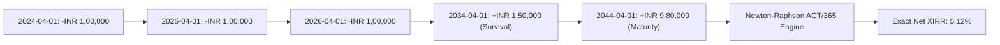

## 1. Why You Must Calculate Cash-Flow IRR

When an insurance advisor or web aggregator advertises a guaranteed savings, endowment, or money-back policy, the headline rate is almost never the compounded rate of return:
* **The "Simple Return" Trap**: An agent takes a total payout of INR 20 Lakhs received on total premiums of INR 10 Lakhs and tells you: *"You are getting a 100% profit, or 10% every year!"*
* **The "Payout Ratio" Trap**: An agent takes an annual payout of INR 1,05,000 against a premium of INR 1,00,000 and proclaims: *"Guaranteed 10.5% return!"*

In financial mathematics, **both claims are mathematically false**. 

To determine whether an insurance product is worth your capital, you must calculate its **Internal Rate of Return (IRR)** or **Extended Internal Rate of Return (XIRR)**.

---

## 2. Mathematical Derivation of the Net Present Value (NPV) Polynomial

The **Internal Rate of Return (IRR)** is the specific discount rate $r$ that equates the Net Present Value (NPV) of all future cash inflows and outflows to exactly zero:

$$\text{NPV}(r) = \sum_{t=0}^{T} \frac{\text{CF}_t}{(1 + r)^t} = 0$$

Where:
* $\text{CF}_t$ is the cash flow at period $t$.
  * Premium payments are **negative** ($\text{CF}_t < 0$).
  * Survival benefits and maturity proceeds are **positive** ($\text{CF}_t > 0$).
* $t$ is the time period in completed years.
* $r$ is the unknown annualized discount rate (the IRR).

### The Root-Finding Problem
Because an insurance contract spans 15 to 35 years, this equation is an **order-$T$ polynomial**. There is no closed-form algebraic formula to solve for $r$. 

Instead, computers and financial calculators solve this polynomial iteratively using the **Newton-Raphson Root-Finding Algorithm**:

$$r_{k+1} = r_k - \frac{f(r_k)}{f'(r_k)}$$

Where:
$$f(r) = \sum_{t=0}^{T} \frac{\text{CF}_t}{(1 + r)^t}$$

And the first derivative with respect to $r$ is:
$$f'(r) = -\sum_{t=1}^{T} \frac{t \cdot \text{CF}_t}{(1 + r)^{t+1}}$$

The algorithm begins with an initial estimate (typically $r_0 = 0.05$) and iterates until $|r_{k+1} - r_k| < 10^{-7}$, converging on the exact internal rate of return.

---

## 3. Why XIRR is Mandatory for Real Insurance Contracts (ACT/365 Convention)

Standard IRR assumes perfectly equal 365.00-day intervals. In reality:
* Leap years introduce an extra 366th day every 4 years.
* Premiums paid quarterly or half-yearly fall on irregular calendar months (e.g., February has 28 days, March has 31).
* Survival payouts are credited on specific policy anniversary dates.

The **Extended Internal Rate of Return (XIRR)** solves the generalized discounting polynomial using **exact calendar day counts under the ACT/365 convention**:

$$\sum_{i=0}^{N} \frac{\text{CF}_i}{(1 + r)^{\frac{d_i - d_0}{365.0}}} = 0$$

Where:
* $d_i$ is the exact calendar date of cash flow $i$.
* $d_0$ is the date of the initial premium payment.
* $\frac{d_i - d_0}{365.0}$ is the exact fractional year elapsed.



---

## 4. Worked Step-by-Step Case Study: Auditing a Real 20-Year Policy

Let us audit a popular guaranteed savings plan often marketed as *"Pay 1 Lakh for 10 years, get 1.5 Lakhs every 5 years + 15 Lakhs at maturity"*:

### Cash-Flow Ledger Table

| Calendar Date | Policy Milestone | Cash Flow Sign | Amount (INR) |
|---|---|---|---|
| **2026-10-10** | Year 1 Premium Outflow | Negative | **-1,00,000** |
| **2027-10-10** | Year 2 Premium Outflow | Negative | **-1,00,000** |
| **2028-10-10** | Year 3 Premium Outflow | Negative | **-1,00,000** |
| **2029-10-10** | Year 4 Premium Outflow | Negative | **-1,00,000** |
| **2030-10-10** | Year 5 Premium Outflow | Negative | **-1,00,000** |
| **2031-10-10** | Year 6 Premium Outflow | Negative | **-1,00,000** |
| **2032-10-10** | Year 7 Premium Outflow | Negative | **-1,00,000** |
| **2033-10-10** | Year 8 Premium Outflow | Negative | **-1,00,000** |
| **2034-10-10** | Year 9 Premium Outflow | Negative | **-1,00,000** |
| **2035-10-10** | Year 10 Premium Outflow | Negative | **-1,00,000** |
| **2036-10-10 to 2045-10-10** | Deferment Window (10 Years) | Zero | 0 |
| **2046-10-10** | Year 20 Full Terminal Maturity | Positive | **+23,50,000** |

### Execution in Spreadsheets (Excel / Google Sheets)
1. In Column A, input the exact dates (`A1:A11` = `2026-10-10` to `2046-10-10`).
2. In Column B, input the exact cash flows (`B1:B10` = `-100000`, `B11` = `2350000`).
3. In Cell B12, enter:
   `=XIRR(B1:B11, A1:A11)`
4. The cell evaluates to:
   $$\mathbf{\text{Net Annualized XIRR}} = \mathbf{5.64\%}$$

### The Reality Check
* **Total Premium Deposited**: INR 10,00,000.
* **Maturity Received**: INR 23,50,000.
* **Headline Profit**: +135% gross profit.
* **True Compounded Return**: **5.64% per year**.
* Compare this to the **Public Provident Fund (PPF)** yielding **7.10% tax-free sovereign return**. Over the same 20 years, an identical INR 1,00,000 annual deposit into PPF compounds to **INR 31,45,000** (+INR 7.95 Lakhs more wealth)!

---

## 5. Programmatic Implementation: Python Script for Policy Audits

For software engineers, data analysts, and actuarial researchers, here is the exact Python implementation to calculate policy XIRR using the `scipy.optimize` root finder:

```python
import datetime
from scipy.optimize import newton

def calculate_xirr(cash_flows):
    """
    Computes exact XIRR using ACT/365 convention.
    cash_flows: List of tuples (date_str 'YYYY-MM-DD', amount_float)
    """
    dates = [datetime.datetime.strptime(d, "%Y-%m-%d") for d, _ in cash_flows]
    amounts = [amt for _, amt in cash_flows]
    d0 = dates[0]
    
    # Pre-calculate elapsed year fractions
    year_fractions = [(d - d0).days / 365.0 for d in dates]
    
    def npv(r):
        return sum(amt / ((1.0 + r) ** yf) for amt, yf in zip(amounts, year_fractions))
    
    def npv_prime(r):
        return sum(-yf * amt / ((1.0 + r) ** (yf + 1.0)) for amt, yf in zip(amounts, year_fractions))
    
    # Solve root via Newton-Raphson
    solved_irr = newton(npv, x0=0.06, fprime=npv_prime, tol=1e-7, maxiter=100)
    return solved_irr

# Example Policy: 10-Year PPT, Maturity at Year 20
policy_data = [
    ("2026-10-10", -100000.0),
    ("2027-10-10", -100000.0),
    ("2028-10-10", -100000.0),
    ("2029-10-10", -100000.0),
    ("2030-10-10", -100000.0),
    ("2031-10-10", -100000.0),
    ("2032-10-10", -100000.0),
    ("2033-10-10", -100000.0),
    ("2034-10-10", -100000.0),
    ("2035-10-10", -100000.0),
    ("2046-10-10",  2350000.0)
]

rate = calculate_xirr(policy_data)
print(f"Verified Net Policy XIRR: {rate * 100:.2f}%")
# Output: Verified Net Policy XIRR: 5.64%
```

---

## 6. The Hurdle Rate Comparison Matrix

Before committing your capital to any guaranteed endowment, money-back, or capital guarantee plan, compare its calculated XIRR against these Indian benchmark hurdle rates:

| Asset / Benchmark | Risk Profile | Current Sovereign / Market Yield | Tax Status (FY 2026–27) | Minimum Required Premium |
|---|---|---|---|---|
| **Public Provident Fund (PPF)** | Zero Risk (Sovereign) | **7.10%** | 100% Tax-Free | INR 500/year |
| **10-Year GOI G-Sec Bond** | Zero Risk (Sovereign) | **6.95% to 7.15%** | Taxable at slab rate | INR 10,000 on RBI Retail Direct |
| **Senior Citizens Savings Scheme (SCSS)** | Zero Risk (Sovereign) | **8.20%** | Taxable at slab rate | INR 1,000 |
| **Direct Nifty 50 Index Fund** | Market Equity Risk | **11.50% to 12.50%** (15-Yr Historical) | 12.5% LTCG on gains | INR 500/month SIP |
| **Typical Guaranteed Insurance Plan** | Moderate (Insurer Credit) | **5.40% to 6.10%** | Tax-free up to INR 5L | INR 50,000/year (Locked) |

If an insurance plan's XIRR is lower than the risk-free **7.10% PPF rate**, you are accepting lower returns and severe 20-year illiquidity without any economic justification.
