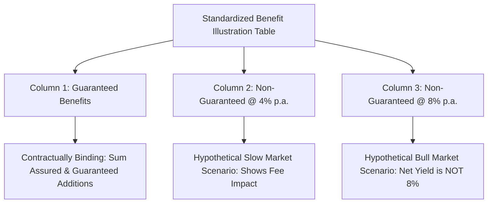

## 1. What is an IRDAI Benefit Illustration?
Before you pay any initial deposit or sign an insurance proposal in India, the intermediary is legally mandated under IRDAI regulations to provide a standardized document titled:
**"Benefit Illustration for [Product Name] — UIN: [Unique Identification Number]"**

Both the prospective policyholder and the advisor must sign this document to certify that the cash flows have been reviewed.

---

## 2. The 3 Crucial Columns You Must Audit

### Column 1: Guaranteed Benefits
* This column contains the **only numbers the insurance company is legally bound to pay you**.
* If a guaranteed income plan promises ₹1,00,000 every year, that amount will appear in this column.
* *Crucial Test*: In a traditional participating endowment policy, the Guaranteed column often shows **only the base sum assured** (e.g. ₹5,00,000), while all bonuses appear in the non-guaranteed columns!

### Column 2: Non-Guaranteed Scenario @ 4% p.a.
* Assumes the insurer's underlying investments earn a gross return of exactly 4.0% per annum every year.
* Often shows net yields of **2.0% to 2.8%** after internal charges are deducted.

### Column 3: Non-Guaranteed Scenario @ 8% p.a.
* Assumes the insurer's underlying investments earn a gross return of 8.0% per annum.
* Sales agents almost always point to the bottom-right corner of this table to show the highest possible number.
* *The Reduction in Yield (RIY)*: Note that even under this optimistic 8% scenario, the **Net Yield (Investor IRR)** is typically **6.2% to 6.8% in ULIPs**, and **5.0% to 5.6% in traditional participating plans**.

---

## 3. The Customer Information Sheet (CIS) Mandate
Under the **IRDAI 2024 Master Circular**, every insurer must now provide a concise 2-page **Customer Information Sheet (CIS)** written in plain English, explaining:
1. Exact policy type and UIN.
2. Sum assured and sum assured on death.
3. Summary of all policy exclusions and waiting periods.
4. Surrender value terms and cancellation charges.
5. Free-look period rights (30 days).
6. Ombudsman details and insurer grievance officer contacts.

---

## 4. 5 Red Flags in Any Insurance Sales Pitch
1. **"The 8% Column is Guaranteed"**: If an agent tells you the 8% column is guaranteed by IRDAI, report them to the insurer's compliance officer. IRDAI explicitly forbids describing illustrative returns as guarantees.
2. **"Higher than Fixed Deposit Returns"**: Traditional endowment plans yield an average net IRR of 5%–6%, lagging high-quality bank fixed deposits and PPF.
3. **"Pay for Just 3 Years and Stop"**: Lapsing a 15-year policy after 3 years triggers punitive surrender deductions that wipe out 30% to 50% of your capital.
4. **"Tax-Free Forever"**: If the annual premium exceeds ₹2.5 Lakh (ULIP) or ₹5 Lakh (Traditional), the maturity is taxable under the Income-tax Act, 2025.
5. **No IRDAI UIN on the Brochure**: Every legitimate life insurance product in India must have a Unique Identification Number (e.g., `105N123V01`). If a brochure lacks a UIN, it is unapproved sales literature.
