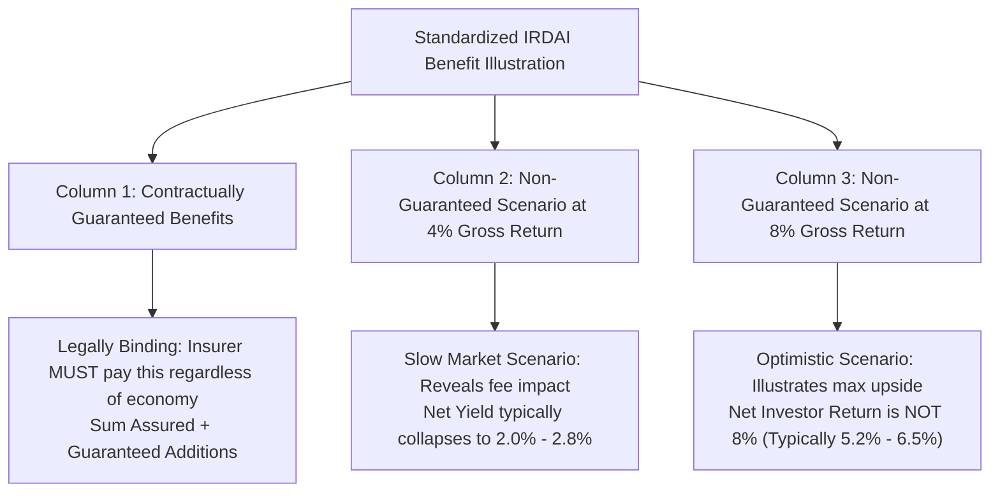

## 1. The Statutory Role of the Benefit Illustration

In the Indian life insurance market, sales presentations are frequently dominated by promotional brochures, colorful presentation slides, and agent assertions of *"Double Your Money"* or *"Guaranteed 10% Income"*.

To protect consumers against deceptive verbal representations, the **Insurance Regulatory and Development Authority of India (IRDAI)** introduced strict statutory guidelines mandating that **every prospective policyholder must receive and sign a customized Benefit Illustration (BI)** before paying any initial premium (except for pure term insurance policies).

The Benefit Illustration is not marketing material. It is a **standardized, legally binding disclosure document** that maps out:
1. Every scheduled cash outflow (annual premiums and applicable taxes).
2. Every contractual deduction (mortality charges, admin charges, FMC).
3. The exact split between **contractually guaranteed** and **non-guaranteed** payouts.
4. The exact **Reduction in Yield (RIY)** that measures the true annual cost drag of the product.

---

## 2. The 3 Crucial Columns Every Buyer Must Audit

When you open an official IRDAI Benefit Illustration from LIC, HDFC Life, ICICI Prudential, or Max Life, your eyes should immediately focus on the three primary benefit columns:

### Column 1: Guaranteed Benefits
* This column contains the **only numbers the insurance company is legally obligated to honor**.
* If an economic crisis strikes, interest rates drop to 2%, or the insurer's investments suffer severe losses, **the company must pay 100% of the numbers in this column**.
* *The Common Agent Deception*: In traditional participating endowment plans (like LIC Jeevan Labh or Jeevan Anand), **Column 1 shows ONLY the basic sum assured** (e.g. INR 5,00,000)! All the lucrative bonuses that the agent promised are listed under Columns 2 and 3 because they are non-guaranteed!

### Column 2: Non-Guaranteed Scenario @ 4% p.a. Gross Return
* Mandated by IRDAI to illustrate what happens if the insurer's underlying investment portfolio earns a conservative **4.0% gross annual return**.
* *What to Audit*: Look at the **Net Yield (Investor IRR)** at the bottom of this column.
* Because internal policy administration fees, distribution charges, and mortality charges are deducted from the 4.0% gross return, the actual net yield to the investor often drops to a meager **1.8% to 2.5%**! In some high-fee products, the net return at 4% gross is negative!

### Column 3: Non-Guaranteed Scenario @ 8% p.a. Gross Return
* Mandated by IRDAI to illustrate what happens if the insurer's investments earn an optimistic **8.0% gross annual return**.
* *The Classic Sales Trap*: Agents routinely point to the large terminal corpus in the bottom right corner of Column 3 and state: *"Sir, you will get an 8% return!"*
* **The Mathematical Reality**: The net yield to the investor is **never 8.0%**. In traditional participating endowment policies, the net yield in Column 3 is typically **5.0% to 5.6%**. In online ULIPs, it is typically **6.2% to 6.8%**. The missing 1.5% to 3.0% per annum has been absorbed by internal insurer deductions!

---

## 3. Reduction in Yield (RIY): Measuring the True Fee Drag

The single most important financial metric on any life insurance illustration is the **Reduction in Yield (RIY)**.

### Mathematical Definition of RIY
$$\text{RIY} = r_{\text{gross}} - r_{\text{net}}$$

Where:
* $r_{\text{gross}} = 8.00\%$ (The hypothetical investment return assumed before deductions).
* $r_{\text{net}}$ is the actual annualized Internal Rate of Return (IRR) received by the policyholder in hand.

### Why RIY Matters to Your Wealth:
Consider an investor paying **INR 1,00,000 per year for 20 years**:

| Product Structure | Assumed Gross Return | Reduction in Yield (RIY) | Net Investor Return | 20-Year Terminal Wealth | Wealth Lost to Charges |
|---|---|---|---|---|---|
| **Direct Index Mutual Fund** | 8.00% | **0.15%** (TER) | **7.85%** | **INR 48,15,000** | INR 95,000 |
| **Online Zero-PAC ULIP** | 8.00% | **1.65%** (FMC + Mortality) | **6.35%** | **INR 39,20,000** | **INR 9,90,000** |
| **Traditional Endowment Plan** | 8.00% | **2.65%** (Admin + Bonus Drag) | **5.35%** | **INR 34,10,000** | **INR 15,00,000** |

Even when all three instruments earn the identical 8.0% gross return in the underlying market:
* The Traditional Endowment plan destroys **INR 15 Lakhs in wealth** through an RIY drag of 2.65% per year!
* The Direct Index Fund preserves virtually all compounding, delivering **INR 14 Lakhs more wealth** than the endowment policy.

---

## 4. The 5 Red Flags to Audit on Any Policy Illustration

Before putting your signature on any proposal form or illustration sheet:

### Red Flag 1: The Disappearing Bonus Illusion
In participating plans, check whether the illustration includes a footnote stating: *"Bonuses are projected at illustrative rates and are not guaranteed."* If the agent told you the bonuses are fixed, they have committed mis-selling.

### Red Flag 2: Mortality Charges Rising Exponentially with Age
In ULIP illustrations, look at the **"Mortality Charges Deducted"** column for Year 15 and Year 20. Notice how the monthly deduction increases 300% to 500% as you enter your 50s. If the stock market experiences a bear market while mortality charges are peaking, your fund units will be depleted rapidly to maintain the death cover.

### Red Flag 3: Unsigned or Generic Illustrations
Insurers are legally prohibited from relying on generic brochures. The illustration **must be personalized** with your exact age, gender, smoking status, premium paying term, and basic sum assured. Both you and the intermediary must sign this specific sheet.

### Red Flag 4: High Upfront Allocation Charges
In offline traditional policies, inspect the first-year Net Invested Amount column. If you pay INR 1,00,000 and the net allocation shows only INR 85,000, the insurer has extracted a 15% upfront allocation haircut for agent commissions and marketing expenses.

### Red Flag 5: The Surrender Value Scale in Early Years
Examine the **"Guaranteed Surrender Value"** column for Year 1, Year 2, and Year 3. Notice that if you pay INR 1,00,000 in Year 1, the guaranteed surrender value in Year 1 is almost always **INR 0**. In Year 2, it is typically only 30% of Year 2 premium. This confirms the severe illiquidity of the contract.

---

## 5. The Policyholder's Pre-Signing Audit Protocol

1. **Locate the Net Yield Percentage**: Turn to the summary page and locate the exact Net Yield calculated under the 8% scenario. If the net yield is below 6.0%, do not sign.
2. **Verify That You Hold Pure Term Cover First**: Confirm that you have an active pure term policy of at least 15x to 20x annual income before allocating capital to any savings illustration.
3. **Save the PDF of the Signed Illustration**: Keep the digitally signed copy in your permanent records. If a dispute arises at maturity, this document is admissible before the Insurance Ombudsman as primary evidence of contractual disclosures.
