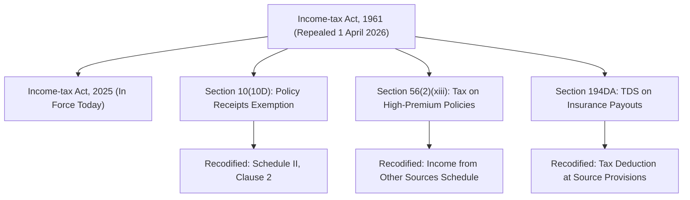

## 1. The Statutory Landscape: Enactment of the Income-tax Act, 2025

Effective **April 1, 2026** (Financial Year 2026–27 / Assessment Year 2027–28), the **Income-tax Act, 2025** came into force across India, replacing the six-decade-old Income-tax Act, 1961.

While the new statute modernizes language and consolidates schedules, it preserves structural continuity for life insurance taxation through **Schedule II, Clause 2 (Schedule II(2))**, which supersedes the historical Section 10(10D).



To navigate life insurance taxation accurately in **October 2026**, every policyholder, taxpayer, and financial planner must master the **Three Statutory Pillars of Exemption**.

---

## 2. Pillar 1: Universal Exemption on Death Benefits

Under **Schedule II, Clause 2**, any sum received on the **death of the life assured** is **100% tax-free** in the hands of the nominee:
* **Applies Universally**: Across pure term insurance, traditional endowments, whole life, ULIPs, money-back policies, and capital guarantee plans.
* **Zero Premium Cap**: Even if the deceased paid INR 50 Lakhs in annual premiums, the entire death benefit is 100% tax-free.
* **Zero Cover Multiple Restriction**: The 10% premium-to-sum-assured rule does **not** apply to death claims.
* *Sole Statutory Exception*: Keyman Insurance policies taken by a corporate entity on the life of an employee, where the claim proceeds are paid to the business.

---

## 3. Pillar 2: The 10% Premium-to-Sum-Assured Ratio Test

To qualify for tax exemption on **maturity or survival benefits**, the policy contract must maintain a statutory minimum life cover relative to the annual premium:

| Policy Issuance Date | Statutory Test (Maximum Permissible Annual Premium) | Minimum Cover Multiple Required |
|---|---|---|
| **On or after 1 April 2012** | Annual premium must **NOT exceed 10%** of Basic Sum Assured | Minimum **10 times** Annual Premium |
| **1 April 2003 to 31 March 2012** | Annual premium must **NOT exceed 20%** of Basic Sum Assured | Minimum **5 times** Annual Premium |
| **Policies for Persons with Severe Disability** | Annual premium must **NOT exceed 15%** of Basic Sum Assured | Minimum **6.67 times** Annual Premium |

### The Severe Penalty for Breach:
If this ratio test is breached in **any single policy year**:
* The entire policy permanently loses its Schedule II(2) tax exemption.
* 100% of the maturity payout (or surrender value) becomes taxable income in the year of receipt.

---

## 4. Pillar 3: The Statutory Annual Premium Caps

Even if a policy satisfies the 10% ratio test, Parliament introduced statutory annual premium ceilings to prevent life insurance from being exploited as an untaxed high-yield investment vehicle:

```mermaid
flowchart TD
    Receipt["Life Insurance Payout Received"] --> DeathCheck{"Is it a Death Benefit?"}
    
    DeathCheck -->|Yes| Free["100% Tax-Free under Schedule II(2)<br/>Zero Cap - Zero Tax"]
    DeathCheck -->|No (Maturity / Surrender)| RatioCheck{"Does Annual Premium exceed 10% of Sum Assured?"}
    
    RatioCheck -->|Yes| TaxableAll["100% Taxable as Income from Other Sources"]
    RatioCheck -->|No| TypeCheck{"Policy Type Audit"}
    
    TypeCheck -->|ULIP issued on/after 1 Feb 2021| ULIPCheck{"Aggregate Annual Premium > INR 2,50,000?"}
    TypeCheck -->|Non-ULIP issued on/after 1 Apr 2023| NonULIPCheck{"Aggregate Annual Premium > INR 5,00,000?"}
    
    ULIPCheck -->|No| TaxFreeULIP["100% Tax-Free under Schedule II(2)"]
    ULIPCheck -->|Yes| TaxableULIP["Taxed as Equity Capital Gains"]
    
    NonULIPCheck -->|No| TaxFreeNonULIP["100% Tax-Free under Schedule II(2)"]
    NonULIPCheck -->|Yes| TaxableNonULIP["Net Gains Taxed at Slab Rate under Other Sources"]
```

### Cap A: The INR 2,50,000 Threshold for ULIPs
* **Applicability**: Applies to all Unit-Linked Insurance Plans issued on or after **1 February 2021**.
* **Threshold Rule**: If the aggregate annual premium payable across all ULIPs held by an individual exceeds **INR 2,50,000** in any financial year:
  * The maturity proceeds lose exemption under Schedule II(2).
  * The policy is treated as an **equity-oriented capital asset**.
  * Net maturity proceeds are subject to **Long-Term Capital Gains (LTCG) tax** on gains over the statutory exemption limit.

### Cap B: The INR 5,00,000 Threshold for Traditional Non-ULIP Policies
* **Applicability**: Applies to non-linked policies (Guaranteed Savings Plans, Traditional Endowments, Money-Back Policies) issued on or after **1 April 2023**.
* **Threshold Rule**: Maturity proceeds are exempt under Schedule II(2) **only if the aggregate annual premium payable across all such policies does not exceed INR 5,00,000 in any financial year**.
* **Pure Term Exclusion**: Pure Term Life Insurance policies (with zero maturity refund) are explicitly **excluded** from this INR 5 Lakh calculation!

---

## 5. Computation of Taxable Income: CBDT Circular 15/2023 Formula

Under the guidelines issued in **CBDT Circular No. 15 of 2023** and codified under the Income-tax Act, 2025, how is taxable income calculated when an investor exceeds the INR 5,00,000 threshold?

Tax is **not** levied on the gross maturity receipt. Tax is levied **strictly on the net gain**:

$$\text{Taxable Income} = \text{Maturity / Surrender Proceeds} - \sum_{t=1}^{N} \text{Total Premiums Paid on that Policy}$$

Where:
* Only premiums that were **not** claimed as deductions in earlier years are subtracted.
* The resulting net gain is categorized as **Income from Other Sources**.
* It is added to your total income and taxed at your applicable personal income-tax slab rate (e.g. 10%, 15%, 20%, or 30% plus cess and surcharge).

### The Taxpayer's Selection Privilege:
If a taxpayer holds multiple policies whose combined premiums exceed INR 5,00,000, the law grants the taxpayer the right to **select which specific policies to exempt**, provided their combined premiums stay within INR 5,00,000:
* **Example**:
  * Policy 1 (issued FY 2023-24): Annual Premium = INR 3,00,000.
  * Policy 2 (issued FY 2024-25): Annual Premium = INR 3,50,000.
  * Combined Premium = INR 6,50,000 (breaches INR 5 Lakh cap).
  * The taxpayer can choose to declare **Policy 2** (INR 3.5 Lakh) as exempt (since it is $\le$ INR 5 Lakh).
  * **Policy 1** (INR 3 Lakh) then becomes taxable on maturity on its net gain.

---

## 6. Upfront Premium Deductions: The New vs Old Tax Regime Reality

Many insurance advertisements in India still mislead consumers by printing: *"Save Tax up to INR 46,800 under Section 80C!"*

In **October 2026**, taxpayers must understand the structural tax reality:
1. **The Default Tax Regime**:
   * The simplified tax regime is the statutory default regime in India.
   * Under this default regime, **all Chapter VI-A deductions—including the former Section 80C deduction for life insurance premiums—are completely disallowed**.
   * If you file under the default tax regime, paying life insurance premiums provides **INR 0 in upfront tax savings**.
2. **The Old Tax Regime (Optional)**:
   * Only taxpayers who actively opt out of the default regime can claim deductions up to INR 1,50,000 under Section 80C.
   * However, for the overwhelming majority of middle-class and salaried Indians, the lower slab rates of the default regime deliver vastly lower overall tax liability than the old regime with Section 80C deductions.

**Rule of Thumb**: Never buy life insurance simply for an upfront Section 80C tax deduction. 

---

## 7. Tax Deduction at Source (TDS) on Life Insurance Payouts

When an insurer disburses a taxable maturity or surrender payout:
* **TDS Rate**: **5%** on the net income component (Maturity Payout minus Total Premiums Paid).
* **Threshold**: TDS applies if the net taxable income exceeds **INR 1,00,000** in a financial year.
* **PAN Mandatory**: If the policyholder fails to provide a valid PAN linked to Aadhaar, TDS is deducted at **20%**.
* **Advance Tax & Slab Liability**: Deducted TDS reflects in your Form 26AS / AIS. However, if you are in the 30% tax bracket, you remain legally liable to pay the remaining 25% tax plus cess as Advance Tax or Self-Assessment Tax.
