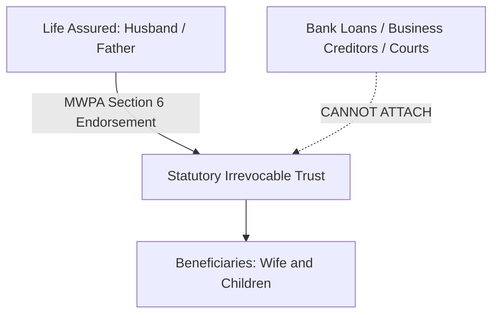

## 1. Defining the Death Benefit Contractually
In insurance policy schedules, the term **Sum Assured** is often distinguished from **Sum Assured on Death**:
* **Sum Assured (Base)**: The nominal face value of the policy.
* **Sum Assured on Death**: The actual contractual sum payable upon death. Under IRDAI regulations, this must be the highest of:
  1. $10 \times \text{Annualized Premium}$ (for regular pay policies).
  2. $105\% \text{ of all premiums paid}$ up to the date of death.
  3. The guaranteed absolute amount assured to be paid on death.

---

## 2. Nominee vs Legal Heir: Section 39 of the Insurance Act
A common point of confusion is whether the nominee is the ultimate owner of the death benefit money.

Historically, before 2015, the Supreme Court of India held (*Sarbati Devi v. Usha Devi, 1984*) that a nominee was merely a trustee or receiver authorized to collect money from the insurer, but had to distribute it among all legal heirs according to succession law.

### The 2015 Amendment: "Beneficial Nominees"
To eliminate family litigation, Parliament amended **Section 39 of the Insurance Act, 1938**:
* If the policyholder nominates their **spouse, children, or parents** (either individually or collectively), these individuals are legally designated as **Beneficial Nominees** (Section 39(7)).
* Beneficial Nominees hold **absolute beneficial ownership** of the death claim proceeds. Distant legal heirs, siblings, or creditors cannot claim any share in the payout.

---

## 3. The Married Women's Property Act (MWPA): Creditor Immunity
If a business owner, software consultant with business loans, or homeowner with an outstanding ₹1 Crore mortgage dies, creditors often attempt to attach personal assets.

To protect your family, you can execute a policy under **Section 6 of the Married Women's Property Act, 1874 (MWPA)** at the time of proposal:
1. The policy immediately becomes an **irrevocable trust** for the benefit of your wife and/or children.
2. The policyholder cannot take a loan against the policy or alter beneficiaries without trustee consent.
3. **Creditor Shield**: Under Section 6(1), the policy money is completely shielded from:
   * Commercial creditors and vendors.
   * Banks and housing finance companies.
   * Court attachment orders.
   * Income Tax recovery notices.

---

## 4. Documentary Checklist for Claim Intimation
When intimating a death claim to an Indian life insurer, the beneficiary must submit:

### Standard Documents (Natural Death)
1. Original Policy Document (Policy Bond).
2. Duly filled Claimant's Statement & Claim Form A.
3. Original or attested Death Certificate issued by the Municipal Corporation / Registrar of Births & Deaths.
4. Physician's Statement / Medical Attendant's Certificate (Form B) from the treating doctor.
5. All hospital records, admission notes, discharge summaries, and diagnostic reports.
6. Identity and address proof of the nominee (Aadhaar / PAN) and cancelled cheque with bank passbook copy.

### Additional Documents (Accidental or Unnatural Death)
1. First Information Report (FIR) certified by the police station.
2. Police Inquest Report / Panchnama.
3. Post-Mortem Examination (PME) Report with chemical viscera analysis (if applicable).
4. Final Police Investigation Closure Report.
