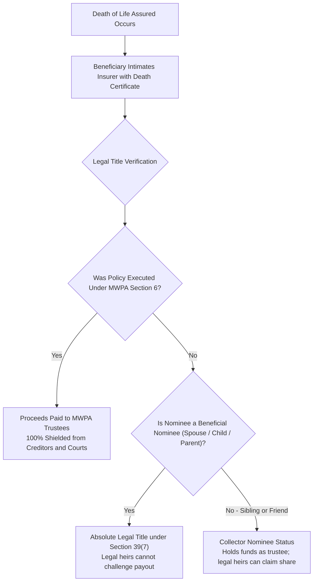
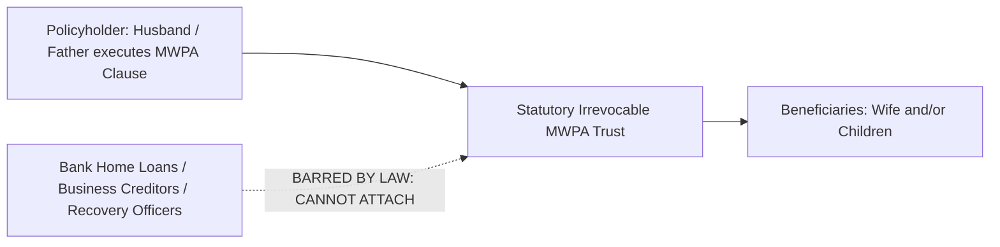

## 1. The Legal Anatomy of an Indian Death Claim

A life insurance policy is an aleatory contract of indemnity triggered by a single catastrophic contingency: **the demise of the Life Assured**.

When this occurs, the insurance company's liability transforms from a contingent risk into an **absolute contractual debt payable to the designated beneficiary**.

However, whether that capital reaches your grieving family smoothly or gets frozen in probate litigation, creditor attachments, or bureaucratic delays depends entirely on three legal structures:
1. **Section 39 Nomination** (Beneficial Nominees vs Collector Nominees).
2. **Section 6 of the Married Women's Property Act, 1874 (MWPA)**.
3. **Statutory Claim Turnaround Times under IRDAI Regulations**.

---

## 2. Beneficial Nominee vs Collector Nominee: The Section 39(7) Revolution

For decades under Indian contract law, a nominee was legally regarded merely as a **"Trustee / Collector"** (affirmed by the Supreme Court in *Smt. Sarbati Devi vs Smt. Usha Devi, 1984*). 

The insurer discharged its liability by paying the nominee, but the nominee did **not** own the money. Distant relatives, siblings, or estranged legal heirs could drag the grieving widow to court and demand their share under Hindu or Muslim Succession Acts.

### The Landmark 2015 Amendment to Section 39(7)
To permanently resolve this vulnerability, Parliament amended **Section 39 of the Insurance Act, 1938**:
* **Section 39(7)** created the statutory status of **"Beneficial Nominee"**:
  > *"Where the holder of a policy of life insurance on his own life nominates his parents, or his spouse, or his children, or his spouse and children, or any of them, the nominee or nominees shall be beneficially entitled to the amount payable by the insurer."*
* **The Legal Consequence**: If your nominee is your **spouse, child, or parent**, they hold **absolute, unchallengeable title to the policy proceeds**. 
* They do not hold the money in trust for other heirs. Other legal heirs have zero right to demand a single rupee.

### What if You Nominate a Sibling, Friend, or Extended Relative?
* If you nominate a brother, sister, cousin, or friend, they remain a **Collector Nominee**.
* They receive the money from the insurer, but remain legally accountable to distribute the proceeds to your statutory legal heirs under personal succession law.

---

## 3. Married Women's Property Act (MWPA) Section 6: The Inviolable Creditor Shield

If you are a salaried earner with a home loan, an entrepreneur with business debt, or a corporate director with personal guarantees, your family's death benefit is vulnerable to creditor attachment unless protected by **MWPA Section 6**.

### The 4 Unbreachable Legal Shields of MWPA:
1. **Creation of an Independent Statutory Trust**:
   * Under Section 6(1) of the MWPA, 1874, the policy bond immediately operates as an independent trust. The policyholder cannot take a policy loan against it, cannot pledge it, and cannot surrender it without the written consent of the trustee.
2. **Complete Creditor Immunity**:
   * The policy money does not form part of the deceased's general estate.
   * Under Section 6, the proceeds **cannot be attached by commercial creditors, vendor lawsuits, bank recovery officers, or personal loan recovery agents**.
3. **Court Attachment Immunity**:
   * No civil court or recovery tribunal in India can issue an attachment order against an MWPA life insurance trust.
4. **Income Tax Recovery Immunity**:
   * Even the Income Tax Department cannot seize MWPA policy proceeds to settle outstanding tax arrears of the deceased breadwinner.

---

## 4. Documentary Checklist for Claim Settlement

When intimating a life insurance death claim in India, the beneficiary must submit a standardized dossier of documents:

### Standard Dossier (Natural / Illness Death):
1. **Original Policy Bond**: The physical or e-Insurance Account (eIA) policy contract.
2. **Claim Form A (Claimant's Statement)**: Duly filled by the beneficial nominee with bank account details (canceled cheque / bank passbook) for direct NEFT disbursement.
3. **Official Death Certificate**: Original or verified attested copy issued by the Municipal Corporation / Registrar of Births and Deaths.
4. **Attending Physician's Statement (Form B)**: Completed by the medical practitioner who certified the death, detailing cause of death and treatment history.
5. **Hospital Treatment Records / Discharge Summary**: Required if death occurred during hospitalization.
6. **Beneficiary KYC Documents**: PAN Card, Aadhaar Card, and proof of residence of the nominee.

### Additional Dossier for Accidental or Unnatural Deaths:
If the death resulted from a road traffic accident, occupational mishap, or unnatural cause:
1. **First Information Report (FIR)** registered with the local Police Station.
2. **Panchnama / Inquest Report** prepared by investigating police officers.
3. **Post-Mortem / Autopsy Report** detailing the official forensic cause of death.
4. **Final Police Investigation Report / Charge Sheet**.
5. **Chemical Viscera Analysis Report** (if toxicological testing was ordered).

---

## 5. IRDAI Claim Settlement Turnaround Times (TAT) & Penal Interest

Under the **IRDAI (Protection of Policyholders' Interests) Regulations, 2024**, life insurance companies are held to strict statutory timelines:

| Claim Processing Stage | Statutory Deadline (IRDAI Mandate) | Regulatory Rule |
|---|---|---|
| **Query Raising** | Within **15 Days** of receiving claim intimation | Insurer cannot raise queries piecemeal |
| **Clean Claim Settlement** | Within **30 Days** of receiving all documents | Applies to claims requiring no field investigation |
| **Investigation Initiation** | Within **30 Days** of claim receipt | Insurer must formally notify beneficiary |
| **Investigation Completion** | Maximum **30 Days** from initiation | Total investigation cannot exceed 30 days |
| **Final Decision on Investigated Claim** | Within **45 Days** of receiving all requirements | Final settlement or repudiation |

### Mandatory Penal Interest for Delay:
If an insurer fails to settle a claim within the prescribed 30-day window without reasonable justification:
* The insurer **must pay penal interest at a rate of 2.0% above the prevailing Reserve Bank of India (RBI) Bank Rate**.
* This interest is calculated from the date of receipt of the last document until the actual date of credit into the beneficiary's bank account.

---

## 6. Taxation of Death Claim Proceeds Under the Income-tax Act, 2025

Under **Schedule II, Clause 2** of the **Income-tax Act, 2025** (in force from 1 April 2026):
* **Every rupee of a life insurance death benefit is 100% tax-free in the hands of the nominee.**
* **Zero Threshold**: The INR 5 Lakh limit on non-ULIP policies and the INR 2.5 Lakh limit on ULIPs apply strictly to *maturity and survival proceeds*. They do **not** apply to death claims.
* Even if the deceased paid an annual premium of INR 20 Lakhs on a high-value policy, the entire death payout (e.g. INR 20 Crores) is completely exempt from income tax in the hands of the beneficial nominee.
