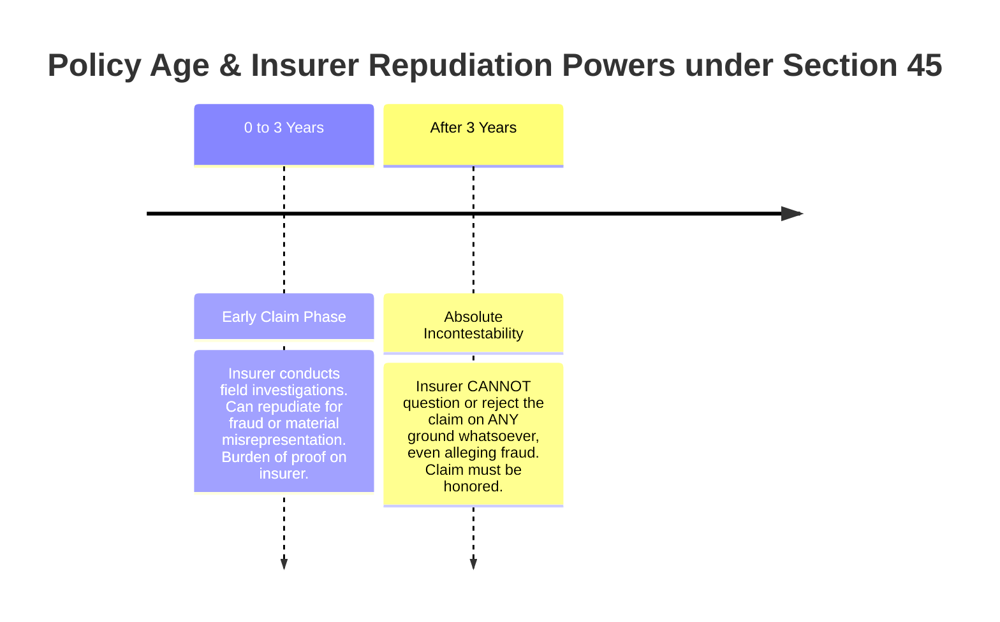
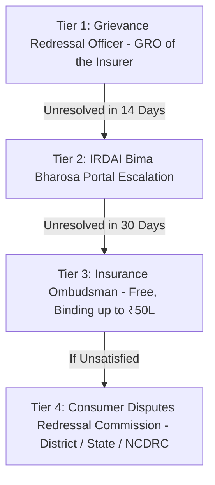

## 1. The Legal Doctrine: Utmost Good Faith (*Uberrima Fides*)
Unlike ordinary commercial contracts caveat emptor ("let the buyer beware"), life insurance contracts in India are founded on the legal principle of **Uberrima Fides** (Utmost Good Faith).

The applicant is legally obligated to disclose every **material fact** within their knowledge that could influence a prudent underwriter in:
1. Deciding whether to accept the risk.
2. Determining the appropriate premium loading.
3. Applying special clauses or exclusions.

---

## 2. Early vs Non-Early Claims & Section 45
The legal vulnerability of an insurance claim depends entirely on the **3-year statutory timeline**:

### The 3-Year Incontestability Shield (Section 45)
Before 2015, insurers routinely dragged families through litigation decades after policy inception, alleging that the deceased had failed to disclose minor ailments.

The **2015 amendment to Section 45 of the Insurance Act, 1938** established an unbreachable statutory wall:
* **Section 45(1)**: Once **three continuous years** elapse from policy issuance, risk commencement, or revival, the insurer **cannot call the policy into question on any ground whatsoever**.
* Fraud, misrepresentation, non-disclosure, or procedural errors cannot be raised after the 3-year window.

### Early Claims (Years 1 to 3): The Investigation Audit
If the life assured dies within 3 years of policy inception:
* The insurer deploys a third-party forensic investigation agency.
* Investigators visit local pharmacies, family doctors, employers, and pathological laboratories within a 5 km radius of the deceased's residence.
* They examine:
  1. Prescription histories for anti-hypertensives, statins, or metformin.
  2. Employer medical leave records and Form 16 reimbursements.
  3. Past health insurance cashless claims filed with Third-Party Administrators (TPAs).
  4. Video recordings from social media or gym memberships indicating high-risk activities.

---

## 3. Top 5 Real-World Grounds for Repudiation

### 1. Undisclosed Lifestyle & Pre-Existing Illnesses
* Concealing hypertension, diabetes, kidney disease, hepatitis, or previous surgeries.
* *Trap*: Believing that "because the agent filled the form, I am not responsible." Under Indian law, the applicant who signs the proposal form adopts all declarations as their own.

### 2. Failure to Disclose Existing Policies Across Other Insurers
* In the proposal form, Section C asks: *"Do you hold any other life insurance policy or pending application with any other insurer?"*
* If you hold ₹1 Crore cover with Insurer A and apply for ₹1.5 Crore with Insurer B without disclosing Insurer A, Insurer B can repudiate an early claim for material non-disclosure of financial underwriting capacity.

### 3. Tobacco & Habit Concealment
* Testing positive for cotinine or having medical records documenting chronic smoking when applying under non-smoker rates.

### 4. Suicide Within 12 Months
* Suicide committed within 365 days of policy issuance or policy revival.

### 5. Policy Lapse at Time of Death
* If premiums were not paid within the 30-day grace period, the policy enters lapsed status. If death occurs during lapse, the insurer is not liable for the death benefit.

---

## 4. The 4-Tier Dispute Resolution Hierarchy
If an insurer repudiates a legitimate claim unfairly, beneficiaries should execute this statutory escalation path:

### The Insurance Ombudsman Advantage
* **Cost**: 100% free; no lawyers permitted or required.
* **Jurisdiction**: Claims up to ₹50 Lakhs.
* **Binding Effect**: Under Rule 17 of the Insurance Ombudsman Rules, 2017, the Ombudsman's award is **legally binding on the insurer within 30 days**. The insurer cannot appeal the award; however, the claimant retains the right to approach consumer courts if unsatisfied.
