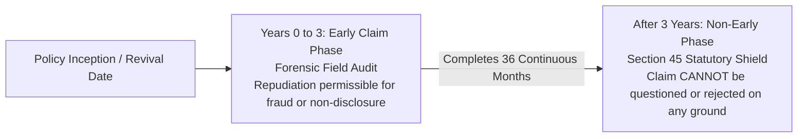
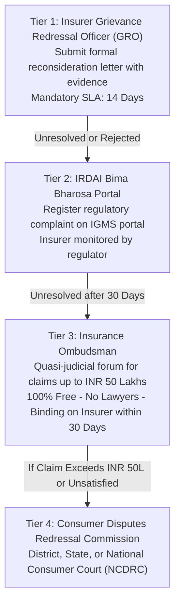

## 1. The Reality of Life Insurance Claim Repudiations

When an insurance company rejects a death claim—termed **claim repudiation** in statutory parlance—it is often catastrophic for a family that has just lost its primary earner.

While Indian life insurers regularly advertise high **Claim Settlement Ratios (CSR)** above 98% or 99%, consumers must understand what that metric actually reflects:
1. **CSR is heavily weighted by mature, low-value policies** (such as small 20-year endowment plans with sum assured under INR 2 Lakhs).
2. For high-value **Pure Term Insurance Claims (INR 1 Crore to INR 3 Crore)** that trigger in the first three years of policy life, the scrutiny is forensic and intensive.

Insurers do not reject claims arbitrarily. They repudiate when their forensic audit uncovers a breach of the legal doctrine of **Uberrima Fides (Utmost Good Faith)**.

---

## 2. Early vs Non-Early Claims & Section 45 Incontestability

Under the **Insurance Act, 1938**, the statutory vulnerability of a life insurance claim depends entirely on the **3-year timeline**:

### The 3-Year Incontestability Shield (Section 45)
Before 2015, life insurers in India could challenge policy claims decades after inception by searching for minor non-disclosures in the proposal form.

To eliminate this practice, Parliament enacted the **2015 Amendment to Section 45 of the Insurance Act, 1938**:
* **Section 45(1)**: Once **three complete years** elapse from the date of policy issuance, the date of commencement of risk, or the date of policy revival (whichever is latest), **the insurer cannot call the policy into question on any ground whatsoever**.
* This statutory shield is **absolute**. Even if the insurer uncovers subsequent evidence alleging fraud, false age declarations, or concealed pre-existing illnesses, they **cannot legally reject the claim**. The claim must be paid in full.

### Early Claims (Years 0 to 3): The Forensic Investigation Audit
If the life assured dies within the first 36 months of policy life:
* The insurer automatically triggers an **Early Claim Investigation**.
* They deploy an accredited third-party forensic investigation firm.
* **The Investigator's Playbook**:
  1. **Medical History Audit**: Investigators visit local hospitals, clinics, and pathological laboratories within a 5 km radius of the deceased's home and workplace to inspect medical records.
  2. **Prescription Trail**: Auditing pharmacy software and drug databases for historical purchases of anti-hypertensives, metformin/insulin, statins, or oncology medications.
  3. **Employer Records**: Requesting Form 16s, leave applications, and medical reimbursement claims from the deceased's HR department.
  4. **Digital & Social Footprint**: Reviewing wearable fitness data, social media posts, and hospital admissions across national Third-Party Administrator (TPA) health insurance portals.
  5. **Insurance Information Bureau (IIB) Cross-Check**: Checking whether the insured held undisclosed life or health policies with other insurers.

---

## 3. Top 5 Real-World Grounds for Repudiation

An analysis of awards issued by the Insurance Ombudsman across India reveals the five predominant grounds for claim repudiation during the early claim window:

### 1. Undisclosed Pre-Existing Health Conditions
* **The Violation**: Failing to declare chronic medical conditions such as diabetes mellitus, hypertension, coronary artery disease, chronic kidney disease, or prior surgeries.
* **The Common Trap**: Relying on an insurance agent who says: *"Don't worry about minor blood pressure, I will mark 'No' on all columns so your policy gets approved fast."*
* **The Legal Consequence**: Under Indian law, the proposer adopts all statements in the proposal form as their own upon signing. Agent misbehavior is not a valid legal defense against repudiation.

### 2. Concealment of Existing Insurance Policies Across Other Insurers
* **The Violation**: Every proposal form includes a mandatory question: *"Do you hold any other active life insurance policies or pending proposals with other insurers?"*
* **The Reason**: Insurers must calculate your aggregate Human Life Value (HLV) to verify that your total life cover does not exceed your economic earning capacity.
* If an applicant holds INR 1.5 Crore cover with Insurer A and applies for INR 2.0 Crore with Insurer B without disclosing Insurer A, Insurer B can repudiate an early claim for material concealment of underwriting risk.

### 3. Tobacco, Nicotine, and Alcohol Misrepresentation
* Declaring oneself as a "Non-Smoker" while testing positive for urine cotinine during post-mortem investigations, or having medical histories documenting smoking-related lung disease.

### 4. Suicide Within the 12-Month Exclusion Window
* Under standard IRDAI policy terms, suicide within 365 days of policy inception or revival results in claim repudiation (though the insurer must refund 80% of premiums paid).

### 5. Lapsed Policy Status at Time of Death
* If the insured fails to pay the premium within the **30-day grace period**, the policy lapses. If death occurs while the policy is in lapsed status, the insurer has zero legal liability to pay the death sum assured.

---

## 4. The 4-Tier Statutory Grievance Redressal Path

If an insurer wrongfully repudiates a legitimate claim, beneficiaries should never immediately hire expensive private lawyers for civil litigation. Instead, execute this statutory, binding escalation hierarchy:

### Tier 1: The Insurer's Grievance Redressal Officer (GRO)
* Send a formal representation to the insurer's GRO detailing medical proofs that refute the repudiation.
* Under IRDAI regulations, the insurer must respond with a formal decision within **14 calendar days**.

### Tier 2: IRDAI Bima Bharosa Portal (Formerly IGMS)
* Register the complaint on IRDAI's **Bima Bharosa** portal (`bimabharosa.irdai.gov.in`).
* IRDAI assigns a unique complaint token and monitors the insurer's response timeline.

### Tier 3: The Insurance Ombudsman (The Consumer's Strongest Shield)
Under the **Insurance Ombudsman Rules, 2017**:
* **Jurisdiction**: Covers personal insurance disputes with claims up to **INR 50,00,000 (INR 50 Lakhs)**.
* **Cost**: **100% Free**. Zero filing fees, zero hearing charges.
* **No Advocates Permitted**: The hearing is informal; insurance companies are legally prohibited from bringing legal advocates. The beneficiary represents their own case.
* **Binding Authority**: Under Rule 17, the Ombudsman's award is **legally binding on the insurance company within 30 days**. The insurer cannot appeal the award. However, if the beneficiary is unsatisfied, they retain the full right to approach consumer courts!

### Tier 4: Consumer Disputes Redressal Commissions
* For claims exceeding INR 50 Lakhs (or where Ombudsman relief was inadequate):
  * **District Commission**: Claims up to INR 50 Lakhs.
  * **State Commission**: Claims between INR 50 Lakhs and INR 2 Crores.
  * **National Commission (NCDRC)**: Claims exceeding INR 2 Crores.

---

## 5. Defensive Underwriting: How to Make Your Policy 100% Bulletproof

To ensure that your family never has to battle an insurance company during their darkest hour:

1. **Disclose Every Hospitalization and Consultation**: Even if a health episode occurred 8 years ago (e.g. minor surgery, dengue hospitalization, or elevated blood pressure during pregnancy), disclose it in writing on the proposal form.
2. **Insist on a Comprehensive Physical Medical Examination**: If the insurer offers to issue an INR 1 Crore policy without medical tests based on your salary slip, **insist on undergoing physical medicals**. Once the insurer's empaneled diagnostic lab conducts blood panels, urine cotinine, and ECG and accepts your proposal, they cannot claim pre-existing disease on those parameters.
3. **Audit Your Proposal Form Copy**: When your policy bond arrives, verify the attached copy of your proposal form. If the agent entered incorrect details, execute your right to submit written corrections within the **30-day free-look period**.
4. **Disclose All Other Policies**: List every existing life policy across LIC and private insurers, including their policy numbers and sum assured.
