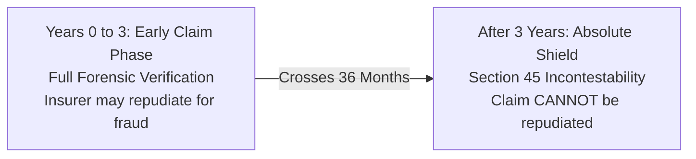

## 1. The Economic Purpose of Risk Pooling: What Insurance Actually Is

At its mathematical and legal foundation, life insurance is **not** an investment vehicle, an accumulation instrument, or a high-yield savings account. It is a collective, aleatory risk-pooling mechanism.

A large, actuarially stratified group of individuals exposed to the uncertain risk of premature mortality contribute an actuarially determined sum (the premium) into a common pool. From this pool, predetermined capital sums (the death benefit) are transferred to the families of the statistical minority who die during the policy term.

When you purchase life insurance, you are purchasing an economic indemnity against a personal financial catastrophe: the abrupt termination of your future human earning capability.

$$\text{Human Life Value (HLV)} = \sum_{t=1}^{N} \frac{E_t - C_t}{(1 + r)^t} + \text{Outstanding Liabilities} - \text{Liquid Family Assets}$$

Where:
* $E_t$ is your expected annual gross earnings in year $t$.
* $C_t$ is your personal consumption expenditure (the personal expenses that cease upon your death).
* $r$ is the post-tax discount rate (typically pegged to the yield on long-term Government of India G-Sec bonds).
* $N$ is the number of remaining productive earning years until planned retirement.

---

## 2. Key Legal Entities in an Indian Insurance Contract

An Indian life insurance policy bond is an enforceable contract governed by the **Insurance Act, 1938**, the **Indian Contract Act, 1872**, and relevant IRDAI Master Regulations. Confusing the roles of the contractual parties is the single most common cause of nomination disputes, probate battles, and tax shocks:

| Legal Entity | Statutory Definition & Role | Practical Indian Scenario |
|---|---|---|
| **Proposer** | The individual who submits the proposal form, declares insurability, and executes the contract with the insurer. | A mother who completes the documentation to insure her breadwinning son. |
| **Life Assured** | The individual whose life is subject to the mortality contingency. If this individual dies, the death benefit triggers. | The breadwinning software engineer whose income supports the family. |
| **Policyholder** | The legal owner holding title to the policy bond and responsible for premium payments. Usually identical to the Proposer. | The individual whose bank account services the annual automated debit. |
| **Beneficial Nominee** | The individual appointed under Section 39(7) to receive policy proceeds upon death with absolute title. | Spouse, children, or parents. Unlike simple collector nominees, they hold title against legal heirs. |
| **Assignee** | A third-party financial entity to whom policy title is transferred under Section 38. | A housing finance bank that takes an absolute assignment on a policy to secure a home loan. |

---

## 3. The 8 Structural Product Archetypes in the Indian Market

Before committing capital on platforms like Policybazaar or through insurance agents, you must identify which structural product archetype is being offered. Life insurance products sold in India fall into eight distinct statutory categories:

### Archetype 1: Pure Protection (Term Life Insurance)
* **Contract Mechanism**: You pay an annual mortality-driven premium solely for risk coverage. 
* **Maturity / Survival Benefit**: Exactly **INR 0**. If you survive the 30-year or 40-year tenure, the policy terminates with no refund of capital.
* **Death Benefit**: 100% of the guaranteed sum assured (typically INR 1 Crore to INR 5 Crore).
* **Representative Market Plans**: HDFC Life Click 2 Protect Super, ICICI Pru iProtect Smart, Max Life Smart Secure Plus, Tata AIA Sampoorna Raksha Promise.
* **Economic Assessment**: The gold standard of financial protection. A 28-year-old non-smoker can secure INR 1 Crore of pure cover until age 65 for approximately INR 10,000 to INR 14,000 annually.

### Archetype 2: Unit-Linked Insurance Plans (ULIPs)
* **Contract Mechanism**: A portion of your premium is deducted for upfront charges and monthly mortality deductions; the remaining corpus is invested in market funds (equity, debt, or hybrid) at Net Asset Value (NAV).
* **Maturity Benefit**: Total Fund Value (Number of Accumulated Units $\times$ Closing NAV).
* **Statutory Lock-in**: Mandatory **5-year lock-in period** under IRDAI regulations. No surrenders or partial withdrawals are permitted before 5 completed policy years.
* **Representative Market Plans**: ICICI Pru Signature, HDFC Life Click 2 Wealth, Max Life Online Savings Plan, Bajaj Allianz Future Gain.
* **Taxation (Income-tax Act, 2025)**: Tax-free on maturity only if aggregate annual premiums across all ULIPs bought on or after 1 February 2021 do **not exceed INR 2.50 Lakhs**. If this limit is breached, capital gains tax applies.

### Archetype 3: Non-Participating Guaranteed Savings & Income Plans
* **Contract Mechanism**: The life insurer contractually guarantees all future cash flows in the policy schedule from Day 1. There are zero market-linked variations and zero discretionary bonuses.
* **Marketing Pitch**: "Guaranteed 10.5% Annual Income for 25 Years" or "Guaranteed Tax-Free Maturity".
* **The Mathematical Reality**: The stated 10% is a simple cash payout relative to premium, not a compounding compound annual growth rate. When discounted over a 30-year horizon, the actual Internal Rate of Return (IRR) is typically between **5.40% and 6.20%**.
* **Representative Market Plans**: HDFC Life Sanchay Plus, ICICI Pru GIFT Pro, Max Life Smart Wealth Plan, Tata AIA Fortune Guarantee Plus.
* **Taxation (Income-tax Act, 2025)**: For policies issued on or after 1 April 2023, if aggregate annual premium across all non-ULIP life policies exceeds **INR 5.00 Lakhs**, maturity gains are taxed under Schedule II / Income from Other Sources at applicable slab rates.

### Archetype 4: Participating Traditional Endowment Plans
* **Contract Mechanism**: Premiums are pooled into the insurer's "With-Profits" participating fund. Returns depend on annual discretionary bonuses (Simple Reversionary Bonus) declared by the insurer based on actuarial valuations.
* **Maturity Benefit**: Base Sum Assured + Accrued Reversionary Bonuses + Final Additional Bonus (FAB).
* **Representative Market Plans**: LIC Jeevan Labh (Plan 936), LIC Jeevan Anand (Plan 915).
* **Historical Net IRR**: Historically between **4.50% and 5.50%**. Illiquid with severe early surrender penalties.

### Archetype 5: Money-Back Plans (With Periodic Survival Benefits)
* **Contract Mechanism**: Instead of waiting for policy maturity, the insurer pays predetermined percentages of the Sum Assured (e.g., 15% or 20%) at regular 3 to 5-year intervals during the policy term, known as **Survival Benefits**.
* **Maturity Benefit**: Remaining percentage of Sum Assured (e.g. 40%) plus accrued simple reversionary bonuses.
* **Representative Market Plans**: LIC Money Back Plan 20 Years (Plan 920), LIC Dhan Rekha (Plan 863), HDFC Life Super Income Plan.
* **The Return Drag**: Because capital is continuously disbursed rather than compounded, the effective annualized XIRR is depressed to **4.00% to 5.10%**. Furthermore, families routinely consume these periodic survival payouts instead of reinvesting them.

### Archetype 6: Capital Guarantee Solutions (The Platform Combo)
* **Structural Reality**: Heavily marketed on online aggregators such as Policybazaar under headlines like *"100% Capital Guaranteed with Stock Market Growth"*. This is **not a single product**—it is a packaged combination of two separate contracts:
  1. A Non-Participating Guaranteed Endowment Plan (absorbing 50%–60% of your annual premium to ensure that the guaranteed payout at maturity equals 100% of all premiums paid across both policies).
  2. A Unit-Linked Insurance Plan (ULIP) (absorbing the remaining 40%–50% to invest in equity markets).
* **The Trade-Off**: You enter two separate 5-year lock-in contracts, incur dual policy administration charges, and pay dual mortality deductions. The overall net IRR rarely exceeds **7.0% to 7.8%**, even in a favorable equity market.

### Archetype 7: Whole Life Insurance Plans
* **Contract Mechanism**: Provides coverage up to age 99 or 100.
* **Representative Market Plans**: LIC Jeevan Umang (Plan 945) (which guarantees an 8% survival benefit of Basic Sum Assured annually after the premium paying term until age 99).
* **Cash-Flow Reality**: While the payout is guaranteed for life, inflation erodes the real purchasing power of the fixed nominal payout over decades.

### Archetype 8: Annuity and Pension Solutions
* **Contract Mechanism**: You deposit a lump-sum purchase price (Immediate Annuity) or pay regular premiums (Deferred Annuity) in exchange for a contractually guaranteed lifetime pension payout.
* **Representative Market Plans**: LIC Jeevan Shanti, HDFC Life Systematic Retirement Plan, ICICI Pru Guaranteed Pension Plan.
* **Taxation**: All annuity cash flows received are **100% taxable as regular income** at your applicable income-tax slab rate.

---

## 4. Master Comparison Matrix of All 8 Insurance Types

The table below contrasts the risk, returns, lock-in, and statutory features of all major Indian life insurance categories:

| Product Archetype | Primary Financial Purpose | Expected Net IRR (Annualized) | Life Cover Provided | Statutory Lock-in | Tax Exemption on Maturity (Income-tax Act, 2025) |
|---|---|---|---|---|---|
| **Pure Term Insurance** | Catastrophic Income Replacement | N/A (Pure Cost) | **100x to 250x** Annual Premium | None (Yearly Renewable) | Death benefit 100% Tax-Free under Schedule II(2) |
| **ULIPs** | Market-Linked Wealth + Basic Cover | 9.0% to 11.0% (Equity) / 6.0% (Debt) | **10x** Annual Premium | **5 Years Mandatory** | Tax-Free if aggregate premium $\le$ INR 2.5L/year |
| **Non-Par Guaranteed Plans** | Predictable Fixed Income | **5.4% to 6.2%** | **10x to 11x** Annual Premium | High Surrender Penalty in Y1–Y3 | Tax-Free if aggregate non-ULIP $\le$ INR 5.0L/year |
| **Traditional Endowment** | Conservative Discretionary Savings | **4.5% to 5.5%** | **10x to 12x** Annual Premium | Minimum 2-3 Years for Paid-Up | Tax-Free if aggregate non-ULIP $\le$ INR 5.0L/year |
| **Money-Back Plans** | Forced Periodic Liquidity | **4.0% to 5.1%** | **10x to 15x** Annual Premium | Minimum 2-3 Years | Tax-Free if aggregate non-ULIP $\le$ INR 5.0L/year |
| **Capital Guarantee Combos** | Principal Protection with Partial Equity | **6.5% to 7.8%** (Blended) | **10x to 15x** Annual Premium | **5 Years** on ULIP Leg | Subject to both INR 2.5L and INR 5.0L thresholds |
| **Whole Life Plans** | Lifetime Cash Flow & Legacy | **5.0% to 5.8%** | **10x** Basic Sum Assured | High Exit Costs | Tax-Free survival payouts if under INR 5.0L threshold |
| **Annuity / Pension Plans** | Post-Retirement Longevity Income | **6.0% to 7.0%** (Annuity Rate) | Minimal / Purchase Price Refund | Irreversible after Purchase | **100% Taxable** at slab rates |

---

## 5. Problem-Solving Case Scenarios: Common Sales Pitches Unpacked

### Scenario A: The Young Salaried Earner Trapped in a Money-Back Pitch
* **The Profile**: Rajiv, age 29, software engineer earning INR 14 Lakhs annually with a spouse and newborn child.
* **The Pitch**: An agent pitches an LIC Money-Back Policy: *"Pay INR 1,00,000 every year for 20 years. Every 5 years you will receive INR 1.5 Lakhs cash back, and at maturity you receive INR 12 Lakhs. Plus you get insurance cover!"*
* **The Hidden Flaws**:
  1. **Death Cover Deficit**: The death cover is only **INR 10 Lakhs** (10 times premium). If Rajiv passes away, INR 10 Lakhs will not sustain his family for even two years.
  2. **The Opportunity Cost**: Applying the XIRR formula to the cash flows yields an annualized return of **4.65%**.
* **The Problem-Solving Solution**:
  * Step 1: Rajiv buys a **Pure Term Insurance Plan** (e.g. HDFC Life Click 2 Protect or ICICI Pru iProtect) for INR 2.0 Crore cover up to age 65 for **INR 15,000/year**.
  * Step 2: The remaining INR 85,000/year is set up as an automated SIP into a Direct Nifty 50 Index Mutual Fund and Public Provident Fund (PPF).
  * Over 20 years @ 11.5% net CAGR, the unbundled portfolio accumulates **INR 62.4 Lakhs**, providing **4x more wealth** and **20x higher death protection** than the Money-Back plan.

### Scenario B: The Conservative Saver Evaluating a "Capital Guarantee Solution"
* **The Profile**: Sunita, age 42, seeks zero capital risk for her daughter's university education in 10 years. She sees a Policybazaar advertisement promising: *"100% Capital Guaranteed with Equity Market Growth!"*
* **The Reality Behind the Curtain**:
  * If Sunita invests INR 2,00,000 annually for 10 years:
  * Policybazaar allocates approximately INR 1,15,000 into a Guaranteed Non-Par Endowment Plan and INR 85,000 into a Large-Cap Equity ULIP.
  * The Non-Par plan guarantees that at Year 10, it will pay exactly INR 20,00,000 (100% of all premiums paid across both policies).
  * Any surplus wealth depends on the INR 85,000 annual ULIP slice.
* **The Hidden Drag**:
  * Sunita pays two sets of mortality charges and fund administration fees.
  * If Sunita faces a financial crisis in Year 3 and needs liquidity, she cannot touch the ULIP leg (5-year lock-in) and surrendering the non-par leg incurs a steep surrender penalty.
* **The Superior DIY Alternative**:
  * Invest INR 1,15,000/year into **Government of India RBI Floating Rate Savings Bonds / PPF** (yielding 7.1% to 7.7% sovereign-backed, guaranteed return).
  * Invest INR 85,000/year into a **Direct Flexi-Cap Mutual Fund** with 0.4% Expense Ratio and 0% mortality deduction.
  * Net outcome: Greater terminal wealth, lower fees, full liquidity after Year 1, and complete transparency.

---

## 6. Critical Contractual Protections Under Indian Law

When you receive your physical or electronic policy bond, verify these statutory clauses immediately:

### 1. The 30-Day Free-Look Right
Under the **IRDAI (Protection of Policyholders' Interests) Regulations, 2024**, every policyholder has a statutory **30-day free-look review window** from the date of physical or electronic delivery.
* If you discover any discrepancy between what the agent promised and what the policy document states, submit a formal cancellation request through the insurer's customer portal.
* The insurer must refund the premium paid, deducting only pro-rata risk premium for the period on cover, stamp duty, and actual medical examination costs incurred.

### 2. Section 45: The Absolute Incontestability Shield
Under **Section 45 of the Insurance Act, 1938** (as amended):
* **0 to 3 Years (Early Claim Period)**: The insurer can investigate and repudiate a claim if they prove material misrepresentation, fraud, or deliberate concealment of facts.
* **After 3 Years (Incontestable Phase)**: Once 3 continuous years elapse from policy issuance, risk commencement, or revival, **the insurer CANNOT call the policy into question or reject a death claim on any ground whatsoever**, including allegations of fraud.

### 3. Grace Period Rules
* **Annual, Half-Yearly, Quarterly modes**: 30 calendar days grace period.
* **Monthly mode**: 15 calendar days grace period.
* If the insured passes away during the grace period, the insurer is legally mandated to pay the full death claim, deducting only the overdue premium installment.

---

## 7. The 5-Point Rulebook for Prospective Policyholders

1. **Separate Risk Protection from Wealth Creation**: Never purchase life insurance to accumulate wealth. Buy pure term life insurance to cover your Human Life Value, and invest in dedicated, transparent assets for wealth accumulation.
2. **Never Let an Agent Fill Your Proposal Form**: Every tick mark regarding medical history, past hospitalizations, tobacco consumption, and family ailments is your personal legal declaration.
3. **Mandate Beneficial Nomination**: Ensure your spouse or children are explicitly designated with PAN and date of birth under Section 39(7).
4. **Demand the Official Benefit Illustration**: Under IRDAI regulations, every non-pure-term policy must be accompanied by a signed benefit illustration showing net yields at 4% and 8% gross scenarios.
5. **Check Total Annual Premium Thresholds**: Under the **Income-tax Act, 2025**, verify that your aggregate annual life insurance premiums do not breach the INR 5 Lakh limit (for traditional non-par plans) or INR 2.5 Lakh limit (for ULIPs) to preserve tax-exempt status.
