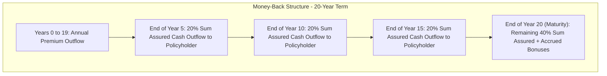
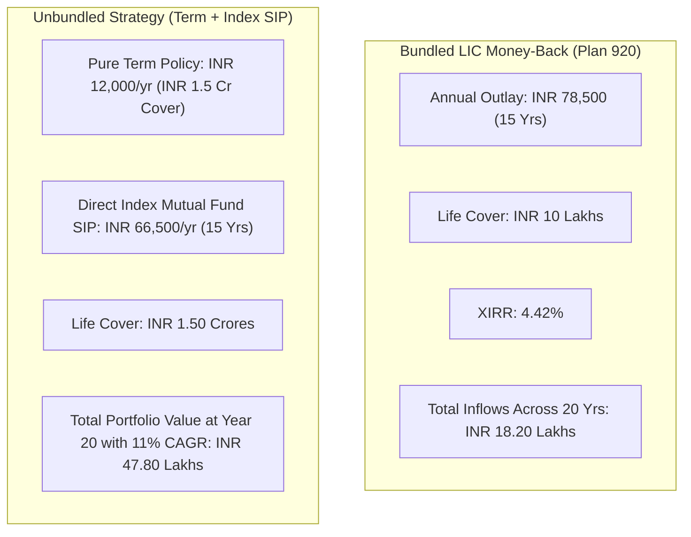

## 1. Defining the Money-Back Life Insurance Contract

A **Money-Back Policy** is a specialized variant of a traditional participating (with-profits) endowment assurance plan. In a standard endowment policy, the entire accumulated maturity amount (Sum Assured plus accrued bonuses) is paid as a single lump-sum at the end of the policy tenure.

In contrast, a Money-Back contract guarantees **periodic liquidity distributions** throughout the policy duration. These intermittent payouts are legally designated as **Survival Benefits**.

### The Popular Indian Money-Back Catalog
* **LIC Money Back Policy 20 Years (Plan 920 / Table 920)**: Premium paying term of 15 years; pays 20% of Basic Sum Assured at years 5, 10, and 15, and the remaining 40% + bonuses at year 20.
* **LIC Money Back Policy 25 Years (Plan 921 / Table 921)**: Premium paying term of 20 years; pays 15% of Basic Sum Assured at years 5, 10, 15, and 20, and 40% + bonuses at year 25.
* **LIC Dhan Rekha (Plan 863)**: A non-linked, participating plan offering periodic survival payments with guaranteed additions.
* **HDFC Life Super Income Plan**: A non-participating variation offering regular guaranteed income payouts for 8 to 15 years after a limited premium payment term.

---

## 2. The Compounding Trap: Why Money-Back Returns Are Chronically Low

Insurance marketing agents heavily emphasize the psychological comfort of receiving "regular payouts every 5 years for your milestones." However, in financial mathematics, **early withdrawals are the lethal enemy of compound growth**.

To understand why, examine how bonuses accrue in traditional Indian participating life insurance:
1. **Simple Reversionary Bonuses (SRB)** are declared annually as a fixed rupee amount per thousand rupees of Basic Sum Assured (e.g., INR 42 per INR 1,000 Sum Assured).
2. The bonus amount does **not compound**. An insurer does not pay interest on declared bonuses. They sit in the insurer's reserve until policy maturity.
3. When the insurer distributes 20% of your Basic Sum Assured as cash back in Year 5, that capital leaves the life fund.
4. If that capital had remained invested in productive assets, it would have earned compounding returns for the remaining 15 years.

### The Mathematical Cash Flow Case Study: LIC Plan 920

Let us analyze a concrete, real-world policy contract:
* **Life Assured Age**: 30 Years
* **Policy Term**: 20 Years (Premium Paying Term: 15 Years)
* **Basic Sum Assured**: **INR 10,00,000**
* **Approximate Annual Premium (with 4.5% GST in Y1, 2.25% in Y2–15)**: **INR 78,500/year**

#### The Contractual Cash-Flow Schedule:
* **Years 1 to 15**: Outflow of INR 78,500 annually (Total Premiums Paid: **INR 11,77,500**).
* **End of Year 5**: Inflow of 20% of Sum Assured = **+INR 2,00,000**.
* **End of Year 10**: Inflow of 20% of Sum Assured = **+INR 2,00,000**.
* **End of Year 15**: Inflow of 20% of Sum Assured = **+INR 2,00,000**.
* **End of Year 20 (Maturity)**:
  * Remaining 40% of Sum Assured = **INR 4,00,000**.
  * Accrued Simple Reversionary Bonus (assuming historical LIC average of INR 38 per thousand per year over 20 years) = INR 7,60,000.
  * Final Additional Bonus (assuming INR 60 per thousand) = INR 60,000.
  * Total Maturity Inflow at Year 20 = **+INR 12,20,000**.

#### Calculating the Exact XIRR:
When we input this exact cash-flow timeline into the Newton-Raphson polynomial solver:

$$\sum_{t=0}^{20} \frac{\text{CF}_t}{(1 + r)^t} = 0$$

$$\mathbf{\text{Exact Annualized Net XIRR}} = \mathbf{4.42\%}$$

### Stated Sales Illusion vs Actual Yield:
* **Total Cash Distributed to Policyholder**: INR 2L + INR 2L + INR 2L + INR 12.2L = **INR 18,20,000**.
* **Total Premium Invested**: **INR 11,77,500**.
* **The Agent's Pitch**: *"You get INR 18.2 Lakhs on an investment of INR 11.77 Lakhs—plus 20 years of life cover!"*
* **The Mathematical Reality**: The net compound return is only **4.42% per annum**.

---

## 3. Money-Back vs Standard Endowment: Head-to-Head Comparison

How does a Money-Back policy compare against a standard Participating Endowment policy (such as **LIC Jeevan Labh Plan 936**) over a similar duration?

| Parameter | LIC Money Back 20 Years (Plan 920) | LIC Jeevan Labh (Plan 936) | Difference / Impact |
|---|---|---|---|
| **Premium Paying Term** | 15 Years | 15 Years (21 Year Policy Term) | Comparable |
| **Survival Benefits** | 20% at Y5, Y10, Y15 | **None** (Full reinvestment) | Money-back provides liquidity |
| **Sum Assured Multiple** | 10x to 12x annual premium | 12x to 14x annual premium | Endowment provides slightly higher cover |
| **Average Bonus Accrual** | Lower (INR 38–40 per 1k) | Higher (INR 44–48 per 1k) | Endowment fund retains capital longer |
| **Net Portfolio XIRR** | **4.42%** | **5.48%** | **+1.06% Higher Annual Return on Endowment** |
| **Terminal Corpus Value** | Lower due to payouts | Higher single lump-sum | Higher compounding base |

---

## 4. The Inflation Erosion Reality: What Is INR 2 Lakhs Worth in 15 Years?

A fatal misconception among buyers of Money-Back policies is treating the future nominal survival payouts as if they possess today's purchasing power.

Assuming a realistic Indian long-term inflation rate of **6.00% per annum**, see how the real purchasing power of the scheduled INR 2,00,000 survival payouts collapses:

$$\text{Real Purchasing Power} = \frac{\text{Nominal Payout}}{(1 + i)^t}$$

| Survival Milestone | Scheduled Nominal Payout | Real Purchasing Power (at 6% Inflation) | Loss in Purchasing Power |
|---|---|---|---|
| **End of Year 5** | INR 2,00,000 | **INR 1,49,451** | -25.3% |
| **End of Year 10** | INR 2,00,000 | **INR 1,11,678** | -44.2% |
| **End of Year 15** | INR 2,00,000 | **INR 83,453** | -58.3% |
| **End of Year 20 (Maturity)** | INR 12,20,000 | **INR 3,80,396** | **-68.8%** |

By Year 15, the INR 2,00,000 survival benefit that seemed like a substantial windfall when you signed the contract at age 30 can only buy what **INR 83,453** buys today. Locking capital into fixed nominal rupee payouts over 15 to 20 years is a recipe for silent wealth destruction.

---

## 5. The Behavioral Hazard: Where Do Survival Benefits Actually Go?

Insurance agents pitch survival benefits as *"money to fund your child's 5th grade school admission, 10th grade coaching, or family milestone."*

However, longitudinal studies of retail personal finance in India reveal a striking behavioral reality:
* **The Mental Accounting Trap**: Because survival benefits arrive in unexpected, intermediate lump-sums of INR 1.5L to INR 2L in a personal savings bank account, they are almost never reinvested into long-term compounding assets.
* **Routine Consumption**: Over **75% of policyholders absorb survival benefits into discretionary lifestyle consumption**—upgrading consumer electronics, booking international holidays, or funding festive expenditures.
* **The Double Whammy**: The investor loses the compounding power inside the insurance fund, and fails to compound the money outside in other assets.

---

## 6. Contractual Death Benefit Mechanics: The Single Silver Lining

There is one critical contractual feature where Indian Money-Back policies (specifically LIC Plan 920 and Plan 921) are uniquely favorable to beneficiaries:

### The Non-Deduction Rule on Death:
In many global insurance contracts, if the life assured dies after receiving survival benefits, past payouts are subtracted from the final death claim. 

Under standard LIC Money-Back policy bonds:
* **Past survival benefits are NEVER deducted from the death claim.**
* If a policyholder receives INR 2,00,000 at Year 5 and INR 2,00,000 at Year 10, and tragically passes away in Year 11:
* The nominee receives **100% of the Basic Sum Assured (INR 10,00,000) + full reversionary bonuses accrued up to Year 11**.
* The insurer does not claw back the INR 4,00,000 already distributed.

*Crucial Warning*: Despite this favorable clause, the absolute death cover (INR 10 Lakhs) remains catastrophically inadequate compared to what a dedicated pure term policy provides for a fraction of the premium.

---

## 7. The Unbundled Alternative: Money-Back vs Term + PPF / Mutual Fund

Let us compare the Money-Back plan against a disciplined **Buy Term, Invest the Difference (BTID)** strategy with an identical annual budget of **INR 78,500**:

### The Financial Scorecard at Year 20:
* **Strategy A (LIC Money-Back)**:
  * Death Cover: **INR 10,00,000**.
  * Total Value Received: **INR 18,20,000**.
* **Strategy B (Unbundled: Term + Index Fund)**:
  * Death Cover: **INR 1,50,00,000** (**15 times more protection**).
  * 20-Year Terminal Wealth @ 11% Net Return: **INR 47,80,000** (**INR 29.6 Lakhs more wealth**).
  * Complete liquidity after Year 1 with zero exit penalties.

---

## 8. Summary Action Guide for Policyholders

1. **If You Are Considering Buying a Money-Back Plan**:
   * Do not proceed. Calculate the Human Life Value needed by your family first. Buy an independent pure term insurance policy for 150x the cover at 1/6th the cost.
2. **If You Already Hold a Money-Back Plan in Year 1 or 2**:
   * Evaluate the statutory 30-day free-look window. If past free-look, evaluate whether stopping further premiums and converting to a paid-up policy or surrendering is economically rational.
3. **If You Are in Year 12 of a 15-Year Premium Paying Term**:
   * Do not surrender now. The severe early deductions have already been absorbed. Continue servicing the remaining 3 premiums to maturity, but ensure that any survival benefits you receive are immediately swept into high-yielding, inflation-beating mutual funds or sovereign debt rather than spent on lifestyle consumption.
