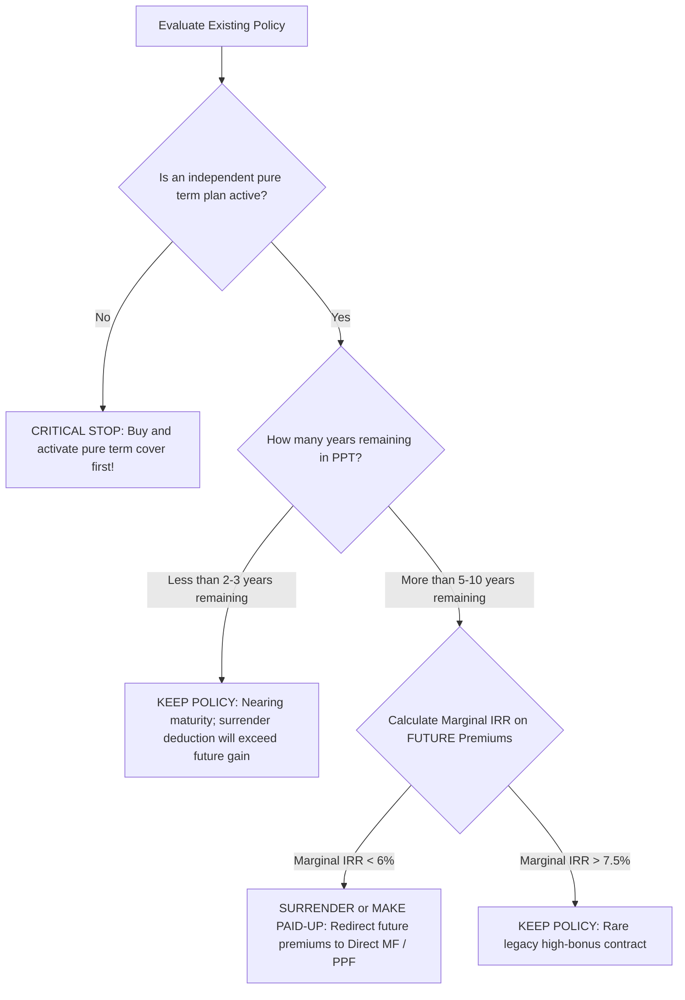

## 1. The Emotional Dilemma: The Sunk Cost Fallacy
The most common psychological obstacle Indian investors face when reviewing an underperforming traditional endowment plan is the **Sunk Cost Fallacy**:
> *"I have already paid ₹50,000 per year for 4 years (Total ₹2,00,000). The insurer is offering a surrender value of only ₹95,000. If I surrender, I will lose ₹1,05,000 of my hard-earned money!"*

### The First-Principles Economic Truth:
The ₹1,05,000 difference is **already gone**. It was consumed by upfront agent commissions, underwriting expenses, and mortality charges in the first few years. 

Continuing to pay ₹50,000 every year for the next 11 years will **not bring that ₹1,05,000 back**. You cannot fix an unprofitable past decision by pouring more good money into a 5% returning asset.

The only rational question is:
$$\text{Will my FUTURE premium payments generate more wealth inside this policy, or outside it?}$$

---

## 2. The 3 Technical Surrender Options

### Option 1: Guaranteed Surrender Value (GSV)
* Under IRDAI regulations, every traditional policy contains a contractual GSV table in the policy bond.
* GSV is calculated as:
$$\text{GSV} = (\text{Total Premiums Paid} - \text{First Year Premium}) \times \text{GSV Factor} + (\text{Accrued Bonuses} \times \text{Bonus Factor})$$
* For policies in year 2 or 3, GSV factors are typically **30% to 35%**, resulting in massive capital loss.

### Option 2: Special Surrender Value (SSV)
* Insurers calculate SSV based on actuarial discounting of the paid-up value:
$$\text{SSV} = (\text{Paid-Up Sum Assured} + \text{Accrued Bonuses}) \times \text{SSV Factor}$$
* Under the **IRDAI 2024 Master Circular**, insurers are mandated to provide significantly higher, progressive SSV factors for policies held past the first year.

### Option 3: Converting to Reduced "Paid-Up" Status
If you do not want to take an immediate loss or if you want to keep some life cover without paying any further premiums, you can convert the policy to **Paid-Up status**:
$$\text{Paid-Up Sum Assured} = \text{Original Sum Assured} \times \left( \frac{\text{Number of Premiums Paid}}{\text{Total Premiums Payable}} \right)$$

* Example: A 20-year policy with a ₹10,00,000 Sum Assured where you paid premiums for 5 years:
$$\text{Paid-Up Sum Assured} = \text{INR } 10,00,000 \times \left( \frac{5}{20} \right) = \mathbf{\text{INR } 2,50,000}$$
* The policy remains active until original maturity.
* If you die before maturity, nominees receive the ₹2,50,000 paid-up sum assured plus bonuses accrued up to year 5.
* At maturity, you receive the ₹2,50,000 plus accrued bonuses with zero further payments.

---

## 3. The 4-Step Decision Framework

### The Cardinal Rule of Policy Replacement:
**NEVER surrender, cancel, or stop an existing life insurance policy until an adequate independent pure term insurance policy has been medically underwritten, approved, and issued with the first premium receipt in your hand.** 

If you surrender an old policy first and are subsequently rejected for new term cover due to newly detected medical conditions (e.g. elevated blood sugar or fatty liver), your family will be left completely unprotected.
