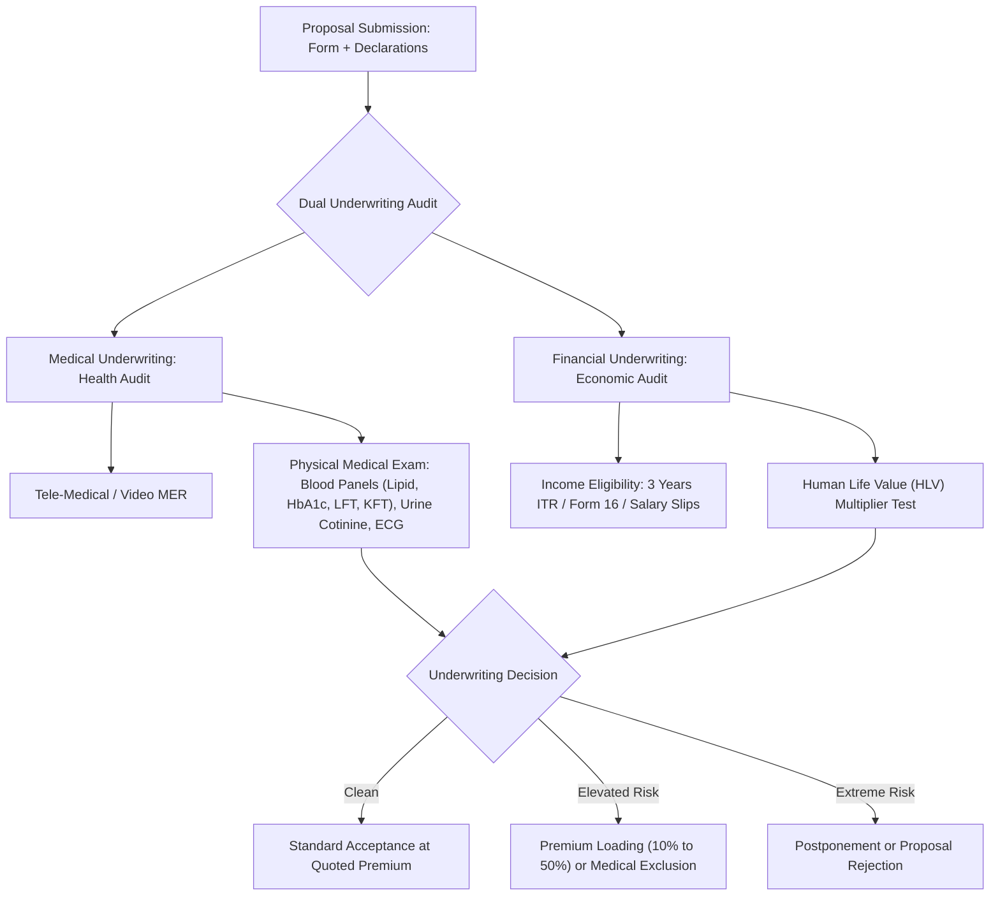
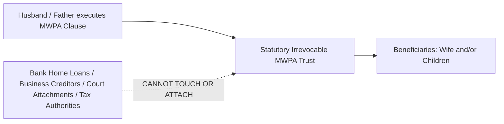

## 1. What is Pure Term Life Insurance?

**Pure Term Life Insurance** is the simplest, most cost-effective, and most vital financial contract available in India. Under a pure term policy:
1. You pay a predetermined, fixed annual premium for a chosen duration (e.g., 30 or 40 years).
2. If you pass away during the active policy term, the insurer pays **100% of the contractually guaranteed Sum Assured** (typically INR 1 Crore to INR 5 Crore) to your beneficiaries.
3. If you survive the term, the policy terminates and the insurer pays **INR 0**.

Because there is zero savings component, zero investment management charge, and zero cash-back surrender value, **virtually 100% of your premium goes towards mortality protection**. 

A healthy 28-year-old non-smoker can secure a **INR 1,00,00,000 (INR 1 Crore)** death benefit up to age 65 for approximately **INR 10,000 to INR 14,000 annually** (less than INR 1,200 per month).

---

## 2. Head-to-Head Comparison of Leading Market Plans

The Indian term insurance market is dominated by four established private life insurers alongside the state-owned LIC. Below is an analytical comparison of the premier plans frequently evaluated on platforms like **Policybazaar**:

| Feature / Plan | HDFC Life Click 2 Protect Super | ICICI Pru iProtect Smart | Max Life Smart Secure Plus | Tata AIA Sampoorna Raksha Promise |
|---|---|---|---|---|
| **IRDAI UIN** | 101N145V01 | 105N151V07 | 104N118V04 | 110N162V02 |
| **Max Entry Age** | 65 Years | 65 Years | 65 Years | 65 Years |
| **Max Coverage Age** | Up to 85 Years / Whole Life | Up to 85 Years / Whole Life | Up to 85 Years | Up to 85 Years / Whole Life |
| **In-Built Terminal Illness** | Yes (100% Accelerated up to INR 2 Cr) | Yes (100% Accelerated) | Yes (100% Accelerated) | Yes (100% Accelerated) |
| **Critical Illness Structure** | Accelerated & Additional Options (Up to 60 CI) | Accelerated / Additional (Up to 34 CI) | Accelerated / Additional (Up to 64 CI) | Accelerated / Additional (Up to 40 CI) |
| **Waiver of Premium (WOP)** | On Critical Illness & Disability | On Permanent Disability & CI | On Critical Illness & Disability | On Critical Illness & Disability |
| **Premium Freeze Option** | Yes (Select variants) | No | No | No |
| **Special Features** | Smart Exit Option (surrender with premium refund at specified age) | Smart Exit / Clam for Life | Special Exit Benefit / Cover Continuance | Instant Payout on Claim Intimation |

---

## 3. The Underwriting Architecture: How Insurers Assess Your Risk

When you submit a term insurance proposal, the insurer's underwriting department executes two rigorous audits:

### Financial Underwriting: The HLV Multiplier Table
Insurers do not allow applicants to buy unlimited life insurance cover. They enforce the **Human Life Value (HLV)** ceiling to prevent moral hazard (where a person is worth more dead than alive). 

Insurers apply income multipliers based on your current age:

| Age Band | Maximum Permissible Cover Multiplier (Times Gross Annual Income) | Example (Annual Income: INR 15 Lakhs) |
|---|---|---|
| **20 to 35 Years** | **25x to 30x Annual Income** | Up to INR 4.50 Crores Cover |
| **36 to 45 Years** | **20x to 25x Annual Income** | Up to INR 3.75 Crores Cover |
| **46 to 50 Years** | **15x to 20x Annual Income** | Up to INR 3.00 Crores Cover |
| **51 to 55 Years** | **10x to 15x Annual Income** | Up to INR 2.25 Crores Cover |
| **56 to 60 Years** | **7x to 10x Annual Income** | Up to INR 1.50 Crores Cover |

---

## 4. Evaluating Term Insurance Riders: What to Add and What to Skip

Insurers offer an array of add-on riders. Some provide invaluable catastrophic protection, while others are overpriced marketing gimmicks:

### Rider 1: Comprehensive Critical Illness (CI) Rider
* **How It Works**: Pays a predetermined lump sum (e.g. INR 25 Lakh) upon verified diagnosis of any of 34 to 64 standardized critical illnesses (cancer of specified severity, first heart attack, stroke, kidney failure, major organ transplant).
* **The Structural Nuance: Accelerated vs Additional**:
  * **Accelerated CI**: Deducts the payout from your life cover. If you have INR 1 Crore term cover and claim INR 25 Lakh for a heart attack, your remaining life cover drops to INR 75 Lakh.
  * **Additional CI (Recommended)**: Pays the INR 25 Lakh independently without reducing your INR 1 Crore death benefit.
* **Verdict**: **Highly Recommended** (especially Additional CI), provided premium rates are guaranteed for at least 5 to 10 years.

### Rider 2: Accidental Death Benefit (ADB) Rider
* **How It Works**: Pays an extra sum assured (e.g. an additional INR 50 Lakh) if death occurs solely due to a violent, accidental, external event within 180 days of the accident.
* **The Critique**: If you pass away from an illness or natural causes, this rider pays INR 0. Your family's living expenses do not double simply because you died in a car accident rather than of cardiac arrest.
* **Verdict**: **Optional**. It is generally superior to increase your base pure term cover from INR 1 Crore to INR 1.5 Crore instead.

### Rider 3: Waiver of Premium (WOP) Rider
* **How It Works**: If you suffer Permanent Total Disability (PTD) or are diagnosed with a critical illness, all future term insurance premiums are completely waived, while your full life cover continues active until maturity.
* **Verdict**: **Essential**. Extremely low annual cost (often under INR 500 to INR 1,000/year) that shields your policy from lapsing if you lose your earning ability.

---

## 5. Married Women's Property Act (MWPA) Section 6: The Ultimate Asset Shield

If you are a married man, an entrepreneur, a corporate director, or an individual with home loans, you should execute your term policy under **Section 6 of the Married Women's Property Act, 1874 (MWPA)** at the time of proposal:

### The 4 Unbreachable Legal Protections of MWPA:
1. **Creation of an Irrevocable Trust**: Under Section 6(1), the policy bond immediately operates as an independent statutory trust for the exclusive benefit of your wife and/or children.
2. **Complete Creditor Immunity**: The death benefit does not form part of your general estate. It **cannot be attached by commercial creditors, vendor lawsuits, bank recovery officers, or bankruptcy proceedings**.
3. **Court Attachment Shield**: No court in India can attach MWPA policy proceeds to settle corporate liabilities or unpaid personal debts.
4. **Income Tax Immunity**: Even the Income Tax Department cannot attach the claim proceeds to recover unpaid back taxes of the deceased.

*Crucial Operational Rule*: You **must opt for MWPA at the time of initial application**. You cannot convert a normal policy into an MWPA policy after issuance.

---

## 6. Standard Policy Exclusions: When Will an Insurer Not Pay?

Indian pure term insurance policies have very few standard exclusions under IRDAI regulations:

### 1. Suicide Within 12 Months (The Suicide Clause)
* If the life assured commits suicide within **12 months from the date of commencement of risk** or date of policy revival:
* The insurer does **not** pay the death sum assured.
* The insurer must refund **at least 80% of the total premiums paid** (excluding taxes and rider charges) to the nominee.
* After 12 months have elapsed, death by suicide is **100% covered** under Indian life insurance law.

### 2. Fraud or Material Non-Disclosure within 3 Years
* If the insured conceals pre-existing illnesses (cancer, diabetes, heart surgery, chronic kidney disease) and passes away within the first 36 months, the insurer can repudiate the claim under Section 45.

### 3. Non-Standard Exclusions (Applicable Primarily to Riders):
* Death or disability resulting from participation in criminal acts with criminal intent.
* Intoxication: Operating a motor vehicle under the influence of alcohol or narcotics.
* Active participation in war, civil unrest, or unapproved aviation activities (e.g. unlicensed flying).

---

## 7. Strategic Checklist for Purchasing Term Insurance

1. **Buy Independent Pure Term**: Avoid Return of Premium (TROP) plans. Buy regular pay pure term up to retirement age (60 or 65).
2. **Disclose Everything Honestly**: Never conceal a prior health issue, smoking habit, past rejection, or existing insurance policies. An extra 15% premium loading is a tiny price to pay for a 100% indisputable claim.
3. **Execute Under MWPA Section 6**: If married, tick the MWP Act box on the proposal form to create a creditor-proof shield for your family.
4. **Add Waiver of Premium Rider**: Ensure the policy stays funded if disability or illness terminates your salary.
5. **Set Up Automated NACH Mandates**: Never rely on manual annual reminders. Automate premium deductions to eliminate the risk of inadvertent policy lapsation.
