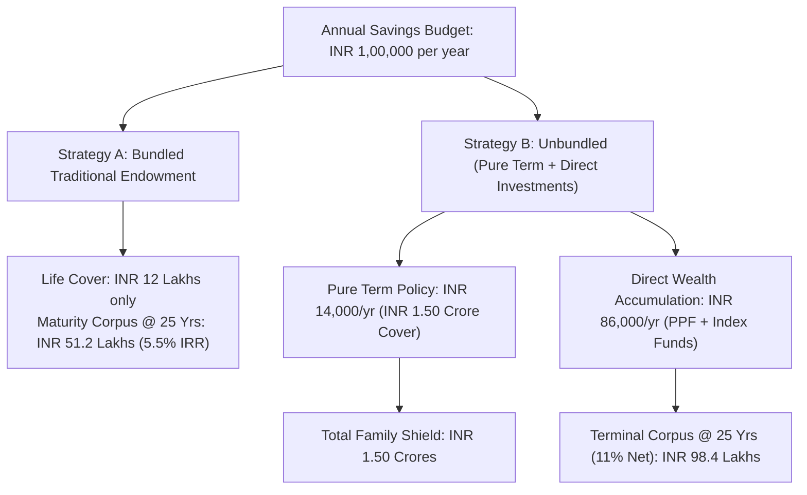

## 1. The Historical Roots of the Bundling Fallacy

In the Indian personal finance landscape, the phrase *"Life Insurance"* has historically been synonymous with traditional **Endowment** and **Money-Back** plans. Products like **LIC Jeevan Labh**, **LIC Jeevan Anand**, and private bank savings plans have been sold for generations under the emotional appeal of:
* *"Bima bhi, Bachat bhi"* (Insurance as well as Savings).
* *"If nothing happens to you, you get all your money back with bonuses!"*
* *"Pure term insurance is a waste of money because you get zero if you survive!"*

This cultural aversion to "wasting" premium on pure mortality protection has caused millions of Indian families to remain catastrophically underinsured. 

When you bundle risk protection and capital accumulation into a single contract, you compromise on both:
1. **The Life Cover is too small to protect your family.**
2. **The Investment Return is too low to beat long-term inflation.**

The remedy is the fundamental principle of financial mathematics known as **Buy Term, Invest the Difference (BTID)**.

---

## 2. Structural Architecture: Bundled vs Unbundled Strategy

---

## 3. The 25-Year Quantitative Case Study

Consider a concrete comparison for a 30-year-old breadwinner with an annual savings capacity of **INR 1,00,000 per year** over a **25-year time horizon**:

### Strategy A: The Bundled Traditional Endowment Plan
* **Annual Premium**: INR 1,00,000 paid annually for 25 years (Total Premiums Paid: **INR 25,00,000**).
* **Life Insurance Cover**: **INR 12,00,000** (12 times annual premium).
* **Return Mechanism**: Traditional with-profits fund earning simple reversionary bonuses.
* **Effective Annualized Net IRR**: **5.50%**.
* **25-Year Maturity Payout**: **INR 51,20,000** (INR 51.2 Lakhs).

### Strategy B: Unbundled (Buy Term, Invest the Difference)
* **Step 1 (The Pure Shield)**:
  * Purchases an independent **Pure Term Insurance Policy** (e.g., HDFC Life Click 2 Protect, ICICI Pru iProtect, or Max Life Smart Secure Plus) with a sum assured of **INR 1,50,00,000 (INR 1.50 Crore)** until age 65.
  * Annual Premium: **INR 14,000/year** (inclusive of 18% GST).
* **Step 2 (The Wealth Engine)**:
  * The residual annual budget of **INR 86,000/year** (INR 7,166/month) is automated through a monthly SIP split between:
    * 50% in the **Public Provident Fund (PPF)** (7.1% tax-free sovereign debt).
    * 50% in a **Direct Nifty 50 Index Mutual Fund** (0.15% TER).
  * Conservative blended net annualized portfolio return: **11.00%**.
  * Total Capital Invested in Wealth Engine: INR 21,50,000.
  * **25-Year Accumulated Terminal Wealth**: **INR 98,40,000** (INR 98.4 Lakhs).

---

## 4. The Comparative Financial Scorecard

| Performance Metric | Strategy A: Bundled Traditional Endowment | Strategy B: Unbundled (Pure Term + Direct SIP) | The Unbundled Advantage |
|---|---|---|---|
| **Annual Cash Outlay** | INR 1,00,000 | INR 1,00,000 | Identical |
| **Total Outlay Over 25 Years** | INR 25,00,000 | INR 25,00,000 | Identical |
| **Life Insurance Cover** | **INR 12,00,000** | **INR 1,50,00,000** | **+INR 1.38 Crore Protection (12.5x higher)** |
| **Terminal Wealth at Year 25** | INR 51,20,000 | **INR 98,40,000** | **+INR 47,20,000 Net Additional Wealth** |
| **Annualized Net Growth Rate** | 5.50% | **11.00%** | **+5.50% Higher Annual Return** |
| **Liquidity in Year 7** | Punitive surrender penalty; policy loan at 9% interest | Mutual fund redeemable in 48 hours; PPF loan/partial exit | **Full Capital Flexibility** |

### Analyzing the Life Cover Gap
Consider what happens if the breadwinner tragically passes away in **Year 8**:
* **Under Strategy A (Bundled)**: The nominee receives **INR 12,00,000** plus accrued bonuses (~INR 16 Lakhs total). For a family with outstanding home loans and young children, INR 16 Lakhs will be exhausted within 2 to 3 years, leaving them in acute financial distress.
* **Under Strategy B (Unbundled)**: The nominee immediately receives **INR 1,50,00,000 (INR 1.5 Crore)** from the pure term policy, plus retains the accumulated mutual fund corpus of **~INR 10,50,000**! Total family security: **INR 1.605 Crores**.

---

## 5. Deconstructing the "Term with Return of Premium" (TROP) Trap

When consumers begin researching pure term insurance on aggregators like Policybazaar, insurers aggressively offer an alternative called **Term with Return of Premium (TROP)**:
* *"If you die, your family gets INR 1 Crore."*
* *"If you survive up to age 65, the insurer refunds 100% of all premiums you paid!"*

### Why TROP is Financially Irrational:
Consider the real market quotes for a 30-year-old non-smoker seeking **INR 1 Crore cover for 35 years**:
* **Standard Pure Term Plan**: **INR 11,000/year**.
* **Term with Return of Premium (TROP)**: **INR 28,000/year**.

In the TROP plan, you pay an extra **INR 17,000 every single year** for 35 years so that the insurer can refund your total paid premiums ($35 \times \text{INR } 28,000 = \text{INR } 9,80,000$) at age 65.

Let us apply the time value of money:
* If you invest that extra **INR 17,000 per year** into a simple Public Provident Fund (PPF) account at 7.1% tax-free for 35 years:
$$\text{Accumulated PPF Corpus at Age 65} = \mathbf{\text{INR } 26,45,000}$$
* The insurer gives you back **INR 9,80,000**.
* By choosing TROP instead of investing the difference in sovereign PPF, **you threw away over INR 16.6 Lakhs in wealth**!
* TROP is an expensive loan you grant to the insurance company at an effective interest rate of roughly **1.8% to 2.2%**.

---

## 6. The Psychological Hurdle: Overcoming the "Zero Maturity" Mental Block

The single reason millions of Indians avoid pure term insurance is psychological:
> *"I cannot stomach paying INR 12,000 every year and getting zero back at the end."*

To overcome this behavioral barrier, use the **Car Insurance Analogy**:
* When you pay INR 25,000 for your car's comprehensive motor insurance, do you expect the insurer to refund your premium at year-end if you did not crash your car?
* No. You celebrate the fact that you did not crash your car, and you recognize that the INR 25,000 bought you complete peace of mind.
* Your Human Life Value—the future income stream that feeds your children and houses your spouse—is worth infinitely more than any automobile. 

Treat pure term life insurance as an **operating expense for family risk management**, not an investment.

---

## 7. The 3-Step Execution Blueprint

1. **Step 1: Calculate Your Required Coverage**:
   * Multiply your annual household living expenses by 15 to 20, and add all outstanding liabilities (home loans, car loans, personal debts).
2. **Step 2: Purchase Pure Term Online**:
   * Buy an independent pure term plan (e.g. HDFC Life Click 2 Protect Super, ICICI Pru iProtect Smart, Max Life Smart Secure Plus) with zero return of premium riders.
3. **Step 3: Automate the Investment Difference**:
   * Set up an automated ECS / NACH mandate on your salary account on the 5th of every month into Direct Index Mutual Funds and PPF.
