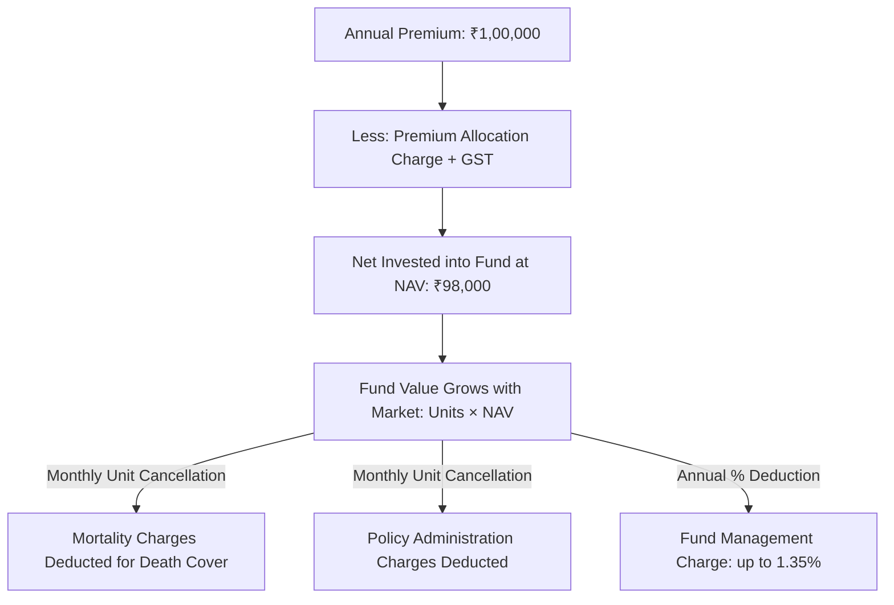

## 1. What is a Unit-Linked Insurance Plan?
A Unit-Linked Insurance Plan (ULIP) is a hybrid financial contract issued by life insurance companies. When you pay a premium into a ULIP:
1. The insurer deducts statutory taxes and permissible upfront charges.
2. The remaining amount is invested in mutual-fund-style investment portfolios (Equity, Debt, Balanced, or Liquid funds).
3. Every month, the insurer **cancels units** from your portfolio to cover the cost of life cover (Mortality Charges) and administration.

---

## 2. The Complete Anatomy of ULIP Charges
To evaluate a ULIP illustration, you must track every deduction:

### A. Premium Allocation Charge (PAC)
* Deducted upfront before any money is invested in units.
* In older offline ULIPs sold by agents, PAC was as high as 6% to 10% in Year 1.
* In modern online ULIPs, PAC is often marketed as "0%", though backend charges remain.

### B. Fund Management Charge (FMC)
* Deducted directly from the daily Net Asset Value (NAV) of the underlying fund.
* Under IRDAI regulations, FMC is capped at a maximum of **1.35% per annum**.

### C. Mortality Charges (The Hidden Cost Drag)
* This is the monthly cost of providing life insurance protection.
* The insurer computes the **Sum at Risk (SAR)**:
$$\text{SAR} = \text{Sum Assured} - \text{Current Fund Value}$$
* The mortality charge is calculated as:
$$\text{Monthly Mortality Charge} = \frac{\text{SAR} \times q_x}{12}$$
Where $q_x$ is the annual mortality rate from IALM 2012-14 tables.
* *Crucial Mechanism*: As you grow older, $q_x$ increases exponentially. Even if your fund value grows, rising mortality charges at older ages can severely deplete your unit balance.

### D. Policy Administration & Miscellaneous Charges
* Fixed monthly charges (e.g. ₹50 to ₹500 per month) deducted by cancelling units.
* In addition, **18% Goods and Services Tax (GST)** is levied on all charges (FMC, mortality charges, and admin fees).

---

## 3. Why Fund NAV Performance Is Not Investor Return
Insurance companies frequently advertise: *"Our Bluechip Equity Fund has generated 14.2% annualized return over the last 10 years!"*

While the **Fund NAV** may indeed have grown at 14.2%, your **personal cash-flow return (XIRR)** will typically be only **10.5% to 11.5%**.

### Worked Example: The Mortality and Admin Drag
Assume a 35-year-old invests ₹1,00,000 per year for 10 years in an online ULIP with a Sum Assured of ₹10,00,000 (10x premium):

| Year | Annual Premium Paid | Gross Fund Return (NAV Growth) | Mortality & Admin Units Cancelled | Year-End Fund Value |
|---|---|---|---|---|
| **1** | ₹1,00,000 | +12.0% | ₹3,200 | ₹1,08,800 |
| **2** | ₹1,00,000 | +12.0% | ₹3,600 | ₹2,28,450 |
| **5** | ₹1,00,000 | +12.0% | ₹4,800 | ₹6,82,300 |
| **10** | ₹1,00,000 | +12.0% | ₹8,900 | ₹17,94,000 |

* Total premiums paid: ₹10,00,000.
* Terminal Fund Value at Year 10: ₹17,94,000.
* **Investor Net Cash-Flow IRR**: **9.82%**.
* **Gross Fund NAV Growth**: **12.00%**.
* **Annual Net Cost Drag**: **2.18% per year**. Over 10 to 15 years, a 2.18% annualized drag compounds into a loss of hundreds of thousands of rupees compared to direct low-cost index investing.

---

## 4. The 5-Year Lock-In & Discontinued Policy Fund
Under IRDAI rules, no funds can be paid out to a policyholder during the first 5 policy years:
* If you stop paying premiums during Years 1 to 4:
  1. Your life cover terminates immediately.
  2. The remaining fund value (less permitted discontinuance charges) is moved into the **Discontinued Policy Fund (DPF)**.
  3. Under IRDAI regulations, the DPF earns a minimum guaranteed floor of **4.0% per annum**, subject to a maximum fund management charge of 0.50%.
  4. The accumulated proceeds are locked until the completion of the 5th policy anniversary.

---

## 5. Taxation under the Income-tax Act, 2025
Following reforms originally introduced in the Finance Act, 2021 and codified under the **Income-tax Act, 2025**:

1. **The ₹2.5 Lakh Threshold**:
   * For ULIPs issued on or after **1 February 2021**, maturity proceeds are exempt under **Schedule II, Clause 2** only if the **aggregate annual premium across all ULIP policies does not exceed ₹2,50,000**.
2. **If Premium Exceeds ₹2.5 Lakh**:
   * The policy loses exemption status.
   * Proceeds upon maturity or surrender are taxed as **Capital Gains**.
   * If the ULIP holds $\ge 65\%$ in domestic equity, it is taxed under the equity capital gains framework (12.5% LTCG above ₹1.25 Lakh).
3. **Death Benefit Exemption**:
   * If the life assured dies during the term, the entire death benefit payout remains **100% tax-free**, regardless of premium amount.
