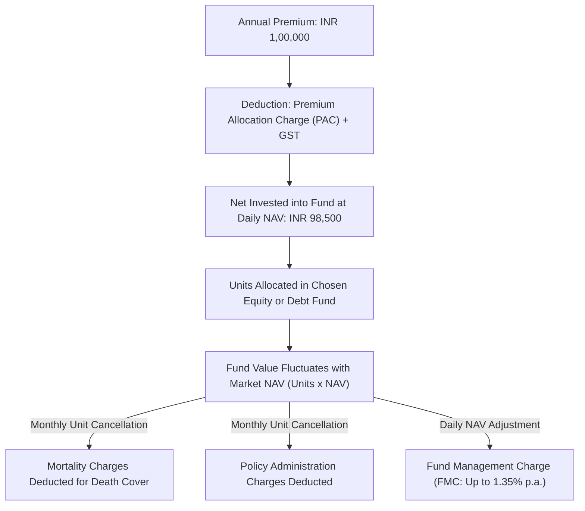

## 1. What is a Unit-Linked Insurance Plan?

A **Unit-Linked Insurance Plan (ULIP)** is a hybrid financial contract issued by Indian life insurance companies that integrates two distinct components:
1. **A Life Insurance Shield**: A death benefit typically equal to the higher of the Sum Assured (usually 10 times the annual premium) or the Fund Value.
2. **A Market-Linked Investment Portfolio**: Units allocated in professionally managed debt, equity, balanced, or liquid portfolios at the prevailing **Net Asset Value (NAV)**.

Prominent modern ULIPs heavily marketed on digital aggregators like **Policybazaar** and direct insurer websites include:
* **ICICI Pru Signature**
* **HDFC Life Click 2 Wealth**
* **Max Life Online Savings Plan**
* **Bajaj Allianz Future Gain**
* **Tata AIA Fortune Pro**

### The Cash-Flow Journey of a ULIP Rupee

When you deposit an annual premium into a ULIP, it undergoes a multi-stage deduction process:

---

## 2. The Complete Anatomy of ULIP Charges

To evaluate an insurer's Benefit Illustration, an investor must audit every single deduction category:

### Charge 1: Premium Allocation Charge (PAC)
* Deducted upfront before any money is converted into fund units.
* **Offline Agent Plans**: Historically charged 5% to 8% in Year 1, and 2% to 4% in subsequent years to finance agent commissions.
* **Modern Online Plans**: Most direct online ULIPs (e.g. HDFC Click 2 Wealth, ICICI Pru Signature) promote **0% PAC**. Every rupee of premium (minus statutory GST) is converted into units.

### Charge 2: Mortality Charges
* The true economic cost of providing the life insurance cover.
* Deducted **monthly by canceling an equivalent number of units** from your fund value.
* **Formula**:
$$\text{Monthly Mortality Charge} = \frac{\text{Sum at Risk (SAR)} \times \text{Mortality Rate}(age)}{12 \times 1000}$$
Where $\text{Sum at Risk} = \max(\text{Sum Assured} - \text{Fund Value}, 0)$.
* *Age Progression Drag*: As you age, mortality rates rise exponentially. A 50-year-old pays roughly 4 to 5 times more in mortality deductions per month than a 25-year-old for the same cover.

### Charge 3: The Return of Mortality Charges (ROMC) Marketing Feature
Modern online ULIPs heavily advertise **"100% Return of Mortality Charges (ROMC)"** at maturity.
* **The Reality**: The insurer does return the nominal rupee sum of all past mortality charges back into your fund upon surviving the full term.
* **The Financial Catch**: The insurer does **not pay you compound interest or opportunity cost** on those deductions. 
* If INR 3,000 was deducted in Year 2, getting that flat INR 3,000 back in Year 20 means you lost 18 years of compound stock market growth on that capital. ROMC is a partial refund, not free life insurance.

### Charge 4: Fund Management Charge (FMC)
* Deducted daily before calculating the Net Asset Value (NAV) of the fund.
* Under IRDAI regulations, FMC is capped at a **maximum of 1.35% per annum** for equity and debt funds.
* While lower than active mutual fund Total Expense Ratios (TERs) of 1.5%–1.8%, remember that a direct index mutual fund charges only **0.10% to 0.20%**.

### Charge 5: Policy Administration Charges
* Charged monthly for maintaining the electronic policy account.
* Either a flat rupee fee (e.g., INR 100/month) or a percentage of premium, deducted by canceling units.

### Charge 6: Discontinuance & Surrender Charges
* Governed strictly by IRDAI caps. If discontinued in Year 1, capped at a maximum of INR 3,000 to INR 6,000 depending on premium size.
* From **Year 5 onwards, discontinuance charges are legally capped at INR 0**.

---

## 3. The 5-Year Mandatory Statutory Lock-In

Under Regulation 34 of the IRDAI (Unit Linked Insurance Products) Regulations, **every ULIP carries an absolute statutory 5-year lock-in period**.

### What Happens if You Stop Paying Premiums in Years 1 to 4?
If you stop paying premiums before completing 5 policy years:
1. Your policy enters **Discontinued Status**.
2. Life cover terminates immediately.
3. Your units are redeemed, and the remaining fund value (minus permissible discontinuance charges) is transferred into the **Discontinued Policy Fund (DPF)**.
4. Under IRDAI mandates, the DPF earns a minimum guaranteed interest rate of **4.0% per annum**.
5. **You cannot withdraw the money immediately.** The proceeds remain frozen in the DPF and are disbursed to you **only upon completion of the 5-year lock-in period from policy inception**.

---

## 4. Taxation of ULIPs Under the Income-tax Act, 2025

For decades, ULIPs enjoyed an enormous tax advantage: complete exemption on maturity under Section 10(10D) regardless of premium size.

Under the modernized **Income-tax Act, 2025** (in force from 1 April 2026), the rules established by Finance Act, 2021 are permanently codified under **Schedule II, Clause 2**:

### The INR 2,50,000 Annual Premium Threshold
1. **Policies Issued on or after 1 February 2021**:
   * Maturity proceeds are **100% tax-free under Schedule II(2) ONLY IF** the aggregate annual premium payable across all your ULIPs does not exceed **INR 2,50,000** in any financial year during the term.
2. **Policies Exceeding INR 2.50 Lakhs**:
   * If total annual ULIP premiums exceed INR 2.5 Lakh in any year, the policy is classified as an **equity-oriented capital asset**.
   * Maturity gains are taxed as **Capital Gains**:
   $$\text{Taxable Capital Gain} = \text{Maturity / Surrender Payout} - \sum \text{Total Premiums Paid}$$
   * Subject to Long-Term Capital Gains (LTCG) tax rates applicable to equity assets (over the statutory basic exemption limit).
3. **Universal Death Benefit Exemption**:
   * If the life assured dies during the term, the death benefit paid to the nominee is **100% tax-free**, even if the annual premium was INR 50 Lakh.

---

## 5. Reduction in Yield (RIY): The True Benchmark of ULIP Cost

Under IRDAI rules, every benefit illustration must state the **Reduction in Yield (RIY)**.

RIY measures the exact gap between the gross return earned by the underlying investments and the net return received by the investor:

$$\text{RIY} = r_{\text{gross}} - r_{\text{net}}$$

Under IRDAI regulations, the maximum permissible RIY for a 15-year policy is **2.25% per annum**.

* If the equity fund earns a gross market return of **8.00%**, the net yield to the investor after all charges cannot be lower than **5.75%**.
* In a Direct Index Mutual Fund, with an expense ratio of 0.15% and zero mortality deductions, the RIY is merely **0.15%**.
* Over a 20-year horizon, a 2.0% annual cost drag results in tens of lakhs of rupees in lost terminal wealth.

---

## 6. Analytical Summary: When Does a ULIP Make Sense?

### Avoid ULIPs If:
1. **You need adequate family protection**: A INR 1 Lakh annual ULIP premium gives you only INR 10 Lakhs in life cover. If you pass away, this leaves your dependants exposed.
2. **You want liquidity within 5 years**: ULIPs are completely illiquid during the statutory 5-year lock-in.
3. **You can invest directly in index mutual funds**: Direct mutual funds provide lower costs, higher transparency, and instant liquidity.

### Consider a ULIP Only If:
1. You have already secured a standalone **Pure Term Policy of at least INR 1 Crore to INR 2 Crore**.
2. Your total annual ULIP investment is strictly under the **INR 2.50 Lakh tax threshold** to maintain 100% tax-free maturity under Schedule II(2) of the Income-tax Act, 2025.
3. You intend to utilize the free asset-allocation switches (moving between debt and equity funds without triggering capital gains tax events during the policy term).
