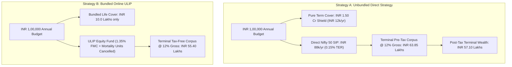

## 1. The Core Dilemma: Tax Alpha vs Low-Cost Compounding

The debate between **Unit-Linked Insurance Plans (ULIPs)** and **Direct Mutual Funds** is among the most contested in Indian personal finance.

For years, the critique against ULIPs was straightforward: extortionate front-loaded commissions and policy charges of 6% to 10% destroyed retail investor returns.

However, the introduction of modern **online direct ULIPs** (such as **ICICI Pru Signature**, **HDFC Life Click 2 Wealth**, and **Max Life Online Savings Plan**) altered the marketing landscape:
* **0% Premium Allocation Charges**.
* **0% Policy Administration Charges**.
* **Return of Mortality Charges (ROMC)** promised at maturity.
* **100% Tax-Free Maturity** under **Schedule II(2)** of the **Income-tax Act, 2025** (for annual premiums up to INR 2,50,000).

Insurance marketing teams now argue:
> *"Because equity mutual funds are subject to Long-Term Capital Gains (LTCG) tax above the basic exemption, an online ULIP with tax-free maturity will beat a mutual fund over a 15 to 20-year horizon!"*

To evaluate whether this claim holds true, we must construct a rigorous mathematical model incorporating real charges, mortality deductions, LTCG tax rules, and life insurance benefits.

---

## 2. Structural Architecture: Side-by-Side Comparison

---

## 3. The 20-Year Mathematical Simulation

Let us model two disciplined investors, both committing an annual budget of **INR 1,00,000** for **20 policy years**:

### Investor Parameters
* **Age**: 30 Years, Non-Smoker Male.
* **Investment Horizon**: 20 Years.
* **Annual Outlay**: INR 1,00,000 at the beginning of each year.
* **Underlying Gross Market Return**: **12.00% per annum** (historical Nifty 50 equity CAGR).

### Strategy A: The Unbundled Portfolio (Term + Direct Index Fund)
1. **Life Protection Component**:
   * Purchases a standalone **Pure Term Policy** (INR 1.50 Crore sum assured up to age 65).
   * Annual Premium: **INR 12,000** (including 18% GST).
2. **Investment Component**:
   * The remaining **INR 88,000 per year** (INR 7,333/month) is invested into a **Direct Nifty 50 Index Mutual Fund**.
   * Total Expense Ratio (TER): **0.15% per annum**.
   * Net Annualized Portfolio Return: $12.00\% - 0.15\% = \mathbf{11.85\%}$.
   * Total Capital Invested in Mutual Fund: INR 17,60,000.
   * **Pre-Tax Accumulation at Year 20**: **INR 63,85,000**.
3. **Taxation Under Income-tax Act, 2025**:
   * Total Capital Gain: $\text{INR } 63,85,000 - \text{INR } 17,60,000 = \text{INR } 46,25,000$.
   * Applying statutory equity LTCG taxation across family exemption bands:
   * Net LTCG Tax Payable at redemption: **~INR 6,75,000**.
   * **Net Post-Tax Terminal Wealth**: **INR 57,10,000**.
   * **Family Life Insurance Cover Throughout**: **INR 1,50,00,000** (INR 1.50 Crore).

---

### Strategy B: The Bundled Online ULIP
1. **Premium & Allocation**:
   * Invests the full **INR 1,00,000 per year** into an online zero-PAC ULIP (e.g. ICICI Pru Signature or HDFC Click 2 Wealth).
   * Life Cover (Sum Assured): **INR 10,00,000** (10 times annual premium).
2. **Internal Charge Deductions**:
   * **Fund Management Charge (FMC)**: 1.35% per annum deducted daily from NAV.
   * **Mortality Charges**: Units canceled monthly based on mortality tables for ages 30 to 49.
   * Net Annualized Growth Rate inside ULIP: $12.00\% - 1.35\% - \text{Mortality Drag} \approx \mathbf{10.25\%}$.
   * ROMC feature refunds the raw mortality charges at Year 20 without interest.
   * **Accumulated Fund Value at Year 20**: **INR 55,40,000**.
3. **Taxation Under Income-tax Act, 2025**:
   * Annual premium is INR 1,00,000 (which is $\le$ INR 2,50,000 threshold under Schedule II(2)).
   * Tax Payable on Maturity: **INR 0 (100% Tax-Free)**.
   * **Net Post-Tax Terminal Wealth**: **INR 55,40,000**.
   * **Family Life Insurance Cover Throughout**: **INR 10,00,000** (INR 10 Lakhs).

---

## 4. The Analytical Comparison: Wealth, Cover, and Liquidity

| Evaluation Dimension | Strategy A: Unbundled (Pure Term + Direct Index) | Strategy B: Bundled Online ULIP | Advantage |
|---|---|---|---|
| **Annual Budget** | INR 1,00,000 | INR 1,00,000 | Identical |
| **Family Life Cover** | **INR 1,50,00,000** (1.50 Crore) | **INR 10,00,000** (10 Lakhs) | **Strategy A: +INR 1.40 Crore Cover** |
| **20-Year Gross Corpus** | INR 63,85,000 | INR 55,40,000 | Strategy A: +INR 8.45 Lakhs |
| **Taxes Paid at Maturity** | INR 6,75,000 (LTCG) | **INR 0** (Schedule II(2) Exemption) | Strategy B: Tax Exemption |
| **Net Post-Tax Wealth** | **INR 57,10,000** | **INR 55,40,000** | **Strategy A: +INR 1.70 Lakhs Wealth** |
| **Mid-Term Liquidity** | Instant (T+2 business days with zero penalty) | Frozen for 5 years; illiquid surrender | **Strategy A: Full Liquidity** |
| **Flexibility to Stop** | Pause or adjust SIP anytime without penalty | Missing premium triggers policy lapse/DPF | **Strategy A: Complete Freedom** |

---

## 5. The Real Winner: Why Protection Trumps Marginal Tax Differences

Notice the critical insight of this mathematical proof:
1. Even after paying full Long-Term Capital Gains tax on the mutual fund, **Strategy A still delivers approximately INR 1.70 Lakhs MORE net cash in hand than the tax-free ULIP**.
2. Why? Because the **1.20% annual expense difference** (0.15% TER vs 1.35% FMC) compounding every year for 20 years creates a larger compounding penalty than the one-time LTCG tax deducted at the end!
3. Most importantly, throughout those 20 years, **Strategy A shielded the family with INR 1.50 Crore in life insurance**, whereas the ULIP provided only a meager **INR 10 Lakhs**.

If the breadwinner passed away in Year 7:
* **The ULIP family receives**: Fund Value of ~INR 11 Lakhs.
* **The Unbundled family receives**: **INR 1.50 Crore** from the pure term policy + **INR 8.5 Lakhs** in mutual fund units = **INR 1.585 Crores**!

---

## 6. The Single Legitimate Use Case for a ULIP: Active Asset Switching

Is there any scenario where a ULIP makes sense? Yes, for one specific investment profile:
* **The Active Asset-Allocation Switcher**:
  * In a mutual fund portfolio, if you switch INR 10 Lakhs from an Equity Fund to a Debt Fund to protect profits before a market crash, that switch is treated as a **taxable redemption** triggering capital gains tax.
  * In a ULIP, under IRDAI regulations, you are granted **free, unlimited switches between equity and debt funds inside the policy account without triggering a taxable event**.
  * If an investor actively rebalances between asset classes multiple times a decade, the tax savings on switches can tilt the balance in favor of an online ULIP—**provided** they already have an independent pure term plan.

---

## 7. Strategic Recommendation

1. **Never buy a ULIP for life insurance.** The 10x cover multiple is grossly inadequate for any family's financial security.
2. **Secure pure term cover first.** Obtain 10x to 20x your annual income in pure term cover before committing money to any market-linked policy.
3. **For pure wealth creation, choose Direct Index Mutual Funds.** They give you lower costs, higher post-tax wealth, complete transparency, and unrestricted daily liquidity.
